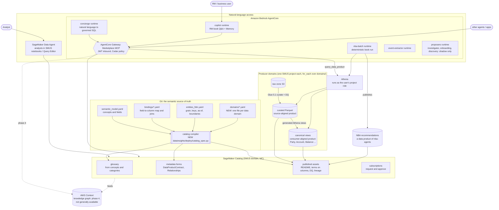

# Target architecture — governed data marketplace + natural-language access + NBA agents on AWS

Status: **DESIGN, NOT BUILT.** Written 2026-11-24 for the project owner.
Nothing here has been applied, deployed or queried on AWS. It builds on
`docs/aws_deployment.md`, which is also not run yet.

Owner decisions this design follows (2026-11-24):

| Decision | Choice |
|---|---|
| Paid AI on AWS | Widen to AWS-native AI: SageMaker Data Agent, catalog AI metadata suggestions, AWS Context once it's generally available, and Bedrock across every AgentCore runtime (one model family). Local profiles, tests and CI stay Ollama-only. |
| Who asks questions in natural language | Analysts in SMUS, RMs and business users, and other agents or apps over MCP |
| Identity | Per user: the caller's identity decides access, and the audit trail names the person |
| Scope | N domains through a generic producer-onboarding pattern, seeded with kernel, lending and market_events |

The widened authorization is **not active** until it is recorded in
`CLAUDE.md` and enforced in `datainsights/config.py` (§9, step 0).

---

## 1. Three principles

1. **Git is the semantic source of truth; the catalog is a projection of it.**
   - The repo already holds what a marketplace needs:
     - `config/semantic_model.yaml` defines the business concepts and their fields;
     - `config/bindings/*.yaml` maps every concept field to a physical column and declares the joins;
     - `config/entities_fdm.yaml` records grain, keys, bi-temporal rules, provenance and boundary notes;
     - `config/categories.yaml` and `config/packs/*.yaml` hold the business vocabulary.
   - A generator compiles all of this into the catalog, the same way `lake_tables.json` is generated today. CI fails on drift.
   - Portal edits are allowed only for fields git doesn't own: ratings, discussion, the subscription workflow.
   - Reason: a detector threshold or the meaning of a term must not change without review, and the local, Snowflake and legacy paths must keep their semantics.
2. **Deterministic where it decides, generative where it explores.**
   - Recommendations come only from the deterministic pipeline.
   - The natural-language agents answer exploratory questions and never produce or rank recommendations.
   - Every generated SQL statement is validated before it runs. Every number in an answer must appear in a query result. This is the same pattern the copilot uses today.
3. **One access system, SMUS.**
   - A consumer gets data by subscribing in SMUS and having the producer approve.
   - Agents never get a standing grant that a human couldn't get through the marketplace.
   - The existing NBA batch agent's LF-tag grant is the one documented exception: it is a service consumer with no human in the loop.

## 2. The architecture



## 3. The data marketplace

### 3.1 Two product tiers per domain (data-mesh standard)

| Tier | What | Who owns the shape | Why |
|---|---|---|---|
| **Source-aligned** | Curated FDM tables (`kernel.party`, `lending.mortgage_agreement`, ...), contract-typed Parquet, Glue DQ | Producer domain, from `entities_fdm.yaml` | Faithful to the system of record; what exists today in `20-data-mesh` |
| **Consumer-aligned** | **Canonical views** (`canonical.party`, `canonical.account`, `canonical.balance_observation`, ...), compiled from `semantic_model.yaml` + the binding: concept-named columns, derived fields (`high_risk_flag`, `product_class`), joins resolved, plus a `_current` view and an `_as_of(date)` pattern for bi-temporal concepts | Platform, generated | **This is what makes natural language work.** An LLM writing SQL against `PRTY_SGMNT_CD` with Type-2 SCD rows double-counts parties. Against `canonical.party_current.segment` it doesn't. |

The canonical views are the semantic layer *executed*: the same binding the
Python `CanonicalSource` interprets, compiled to Athena SQL. A parity test
(like `tests/test_aws_read_path.py`) must prove that view results equal the
`CanonicalSource` results on the local data.

### 3.2 What the catalog holds per asset (generated, not hand-typed)

| Catalog element | Generated from |
|---|---|
| Glossary **"Banking concepts"**: one term per concept, child terms per field (`Party › segment`) | `semantic_model.yaml` |
| Glossary **"NBA categories"** (exists) and **"Signals"** | `categories.yaml`, `domains_fdm.yaml` |
| Terms attached to **columns** | binding field→column maps. The binding *is* the term↔column mapping. |
| Metadata form **`DataProductContract`**: domain, owner, grain, primary key, bi-temporal yes/no + validity columns, as-of rule, freshness SLA, provenance (confirmed / invented), contract_version | `entities_fdm.yaml`, `domains/*.yaml` |
| Metadata form **`Relationships`**: `party_id → canonical.account.party_id (1:N)` ... | binding `joins` + primary keys |
| Asset **README**: purpose, how to join it, as-of guidance, example queries, known limits | template + the above |
| Lineage raw → curated → canonical | Glue 5.1 job lineage in SMUS; OpenLineage events for the views |
| DQ results | Glue DQ (`autoImportDataQualityResult`, exists) |

The Data Agent reads glossary terms, metadata forms, asset summaries and
READMEs. The relationships therefore have to be written into the README as
well as the form, or the Data Agent won't use them.

### 3.3 Boundaries carried into the marketplace

- **`HIGH_RSK_CUST_IND`** must not appear in any general-subscription asset.
  - `canonical.party` excludes it through Lake Formation column-level filtering.
  - A separate restricted asset, `kernel.party_risk_flag`, is approved only for `nba-agents`. Its only permitted use is suppression (the `boundary_note` in `entities_fdm.yaml`).
- **Protected evaluator labels and holdouts are never published.** This is already enforced by construction in `publish_raw.py`, and it stays that way.
- **Deferred FinCrime schemas** are never contracted, so they are never products.

### 3.4 N-domain producer onboarding (self-serve)

1. A producer adds `domains/<name>.yaml`: owner, description, LF-tag value, SLA, glossary steward.
2. They run the existing onboarding kit. `onboarding/profiler.py`, `entity_contract_generator.py`, `binding_proposer.py` and `concept_proposer.py` propose the entity contract and the binding.
3. They open a PR. CI runs the compiler, the drift checks, the parity test and `terraform plan`.
4. On merge, Terraform creates the domain from `for_each` over `domains/`:
   - bucket, Glue DB and job, DQ, SMUS project and domain unit;
   - the catalog content and the canonical views.

`10-foundation`'s `data_domains` list and the `entities_fdm.yaml` `domain:`
tags become derived from `domains/`, so there is one list, not three.

## 4. Identity (per user)

The access unit in SMUS is the **project**: subscriptions grant to the
project's role. The design keeps that native and adds the person:

1. **Users sign in through IAM Identity Center.** That covers the SMUS portal, the RM chat UI and M2M clients (client credentials).
2. **AgentCore checks the IdC-issued JWT.** Runtimes and the Gateway use `custom_jwt_authorizer`. A Cedar policy on the Gateway restricts which tools a group can call. For example, only the `rm` group may call `get_nba_recommendations`.
3. **`query_data_product` runs as the caller's project.**
   - The tool resolves the caller's SMUS memberships (DataZone API) and requires membership in the project named in the call.
   - It then assumes that project's role with `SourceIdentity = <user>`. CloudTrail and Athena history then name the person, not the agent.
   - Access is exactly what that project subscribed to, so nothing exists outside the marketplace.
4. **Book scoping for RMs stays in the tool layer** (`datainsights/identity.py`, existing). Lake Formation row filters can't reference the calling user dynamically, so a per-RM row filter would need one filter per RM.
5. **Later option:** full trusted identity propagation (IdC-enabled Athena workgroup, Lake Formation grants to IdC groups). It needs a reconciler that mirrors SMUS approvals into group grants. It's deferred because it duplicates the SMUS approval system.

Machine clients (other agents/apps) get an AgentCore workload identity
mapped to *their own* consumer project and subscribe like anyone else.

## 5. Natural-language access: three paths, one catalog

| User | Path | What we build |
|---|---|---|
| Analyst | **SageMaker Data Agent** in SMUS notebooks / Query Editor | Nothing agent-side. Quality comes from §3.2, plus the canonical views to query. UI-only: no SDK/CLI, so our agents can't call it. |
| RM / business user | **copilot** runtime: questions about *their* recommendations, plus the concierge for "show me…" questions within their book | Extend `agents/rm_copilot_agent.py` with Memory (session context) and the Gateway tools |
| Other agents / apps | **Marketplace MCP** on AgentCore Gateway | The tools below |

**Marketplace MCP tools** (Gateway targets: Lambda for ours, Smithy for AWS APIs where they fit as-is):

| Tool | Does | Guard |
|---|---|---|
| `search_data_products(text, domain?)` | DataZone Search over published assets + glossary | Returns only assets the caller can see |
| `describe_data_product(asset)` | Schema, terms, `DataProductContract`, `Relationships`, DQ status, freshness, README | None |
| `explain_term(term)` | Glossary definition, linked columns, related terms | None |
| `query_data_product(project, sql)` | Validated, read-only Athena | See 5.1 |
| `request_access(asset, project, reason)` | Creates a SMUS subscription *request* | A human producer approves; never auto-approved by default |
| `get_nba_recommendations(rm_id?)` | Reads the published NBA insights product | Cedar policy: `rm` / `supervisor` groups; book scope from identity |
| `find_related(entity)` | **Phase 4:** AWS Context agentic search | Same as search |

### 5.1 The concierge: natural language to governed SQL

1. **Retrieve:** `search_data_products` and `explain_term` for the question's business terms.
2. **Plan:** choose assets and joins **only from published `Relationships`**. No invented join keys.
3. **Generate SQL** against canonical views by preference.
4. **Validate statically (sqlglot), deterministically, before running:**
   - `SELECT` only;
   - every table is in the caller's subscribed set;
   - every join is a declared relationship;
   - bi-temporal tables are queried through `_current` or with an explicit as-of predicate;
   - `LIMIT` enforced;
   - no restricted columns.
5. **Execute:** Athena workgroup, 1 GB/query cap (exists), as the project role (§4).
6. **Answer with citations:** the assets, terms and SQL used. Numbers are checked against the result set (the copilot's `_validate` pattern). If the check fails, return the table, not prose.

**Evaluation:**
- A golden set, `eval/marketplace_questions.yaml`: question → expected assets and joins, plus expected result shape.
- It is run offline by AgentCore Evaluator and on live traffic by an online evaluation config.
- It is built from synthetic data and business questions, never from protected labels.

## 6. Agents on AgentCore

One image, several runtimes. Strands stays as the agent framework.

| Runtime | Today | Trigger | Model use |
|---|---|---|---|
| `nba-batch` | `agents/entrypoint.py` `book` (exists in `30-agents`) | EventBridge Scheduler daily + on-demand | None for the whole book; narration only on single-client calls |
| `event-extractor` | A1 (`external_events/`) | S3 `ObjectCreated` on the `market_events` raw zone | Extraction; failures go to a review queue (exists) |
| `proposers` | A2 investigator, onboarding, signal discovery | On-demand / weekly | Proposes only. Output goes to shadow (`domains_discovered.yaml`); promotion stays a human PR. |
| `copilot` | A3 | Interactive (JWT) | Narration, validated |
| `concierge` | **New** | Interactive (JWT) + MCP | NL→SQL, validated (§5.1) |

Shared AgentCore services:
- **Gateway:** Marketplace MCP, Cedar policy engine, rate limit.
- **Memory:** copilot and concierge sessions, short-term memory only. No long-term memory of data values.
- **Identity:** inbound JWT, workload identities.
- **Registry:** discovery of the agents and tools by other teams.
- **Observability:** CloudWatch GenAI dashboard (exists in the plan).

The Bedrock guardrail (exists) applies to every runtime. All runtimes use
one model family; a per-task model choice inside the family is allowed
(this repo already measures that per task).

## 7. "One touch": what it really is

**One GitHub Actions workflow, `platform-up` (workflow_dispatch), for each environment.** HCP Terraform stays the plan/apply engine; the workflow orchestrates the order and the non-Terraform steps:

```
platform-up
 1. queue + wait  HCP 10-foundation          (VPC, KMS, buckets, Athena, ECR, LF, IdC lookups, budget)
 2. queue + wait  HCP 20-data-mesh           (for_each domains/: Glue DB/tables/DQ/jobs, SMUS domain, units, projects)
 3. run           publish_raw --curate       (allow-listed CSVs to raw, Glue curate + DQ)
 4. queue + wait  HCP 25-catalog   NEW       (form types, glossaries + terms, data sources publish-on-import,
                                              canonical views, LF grants for project roles, restricted column filter)
 5. run           catalog_sync     NEW       (asset READMEs, form values, term-to-column attachments, lineage:
                                              the asset-level metadata Terraform has no resources for; idempotent)
 6. build+push    agent image                (exists: agent-image.yml)
 7. queue + wait  HCP 30-agents              (5 runtimes, Gateway + targets + Cedar, Memory, Evaluator, Registry, schedules)
 8. run           smoke test                 (book run → S3 + ledger; one concierge question; one MCP search)
```

- **Dev:** auto-apply is on, so it really is one click.
- **Prod-style:** the workflow pauses at each HCP run for a human confirm. That's the point of HCP.
- **Permissions:** the GitHub OIDC role gains only what steps 3, 5 and 8 need (S3 put to raw zones, Glue start, DataZone metadata writes, AgentCore invoke). Applies stay with HCP's apply role.

**Not automatable, once per account. Listed honestly:**
- the Bedrock model-access / Anthropic use-case form;
- enabling IAM Identity Center;
- the HCP bootstrap (local, chicken-and-egg);
- installing the HCP GitHub App;
- `terraform login`.

**Deliberately human:** subscription approval. There's an `auto_approve_subscriptions` flag for demos, off by default.

### 7.1 Terraform coverage (checked against aws 6.70.0 / awscc 1.107.0 schemas, 2026-11-24)

| Need | Resource | Status |
|---|---|---|
| Domain units per data domain | `awscc_datazone_domain_unit` | exists in provider |
| Metadata forms | `aws_datazone_form_type` | exists |
| Glossary + terms | `aws_datazone_glossary(_term)` | exists, already used |
| Glue data source, publish-on-import | `awscc_datazone_data_source` | exists (today a script does it) |
| Subscription target | `awscc_datazone_subscription_target` | exists |
| Gateway / targets (MCP: lambda, smithy, mcp_server, open_api) / JWT / Cedar | `aws_bedrockagentcore_gateway`, `_gateway_target`, `_policy_engine`, `_policy` | exists |
| Memory, Evaluator, online eval, Registry, workload identity | `aws_bedrockagentcore_memory`, `_evaluator`, `_online_evaluation_config`, `_registry`, `_workload_identity` | exists |
| Asset README / form values / term-on-column / lineage | none | `catalog_sync` script (step 5) |
| Data Agent enablement | none known | verify on first apply; may be a portal toggle |
| AWS Context | none | not generally available |

## 8. Risks and assumptions (verify, don't trust)

| # | Item | Status | If wrong |
|---|---|---|---|
| 1 | **AWS Context is not generally available.** Announced 2026-06-17; third-party trackers list it "coming soon" as of 2026-11. | Unverified with AWS directly | Phase 4 waits; nothing else depends on it |
| 2 | **The Data Agent is UI-only** (no SDK/CLI) | Per a 2026-06 third-party test | If an API appears, the concierge could delegate to it |
| 3 | IdC JWT accepted by AgentCore `custom_jwt_authorizer` (IdC as OIDC issuer for the custom app) | Assumed | Put Cognito federated to IdC in front |
| 4 | SMUS project role assumable by the query tool with `SourceIdentity` | Assumed | Fall back to TIP (§4.5) |
| 5 | Lake Formation column filter on the published `canonical.party` coexists with SMUS subscription grants | Assumed | Publish the view without the column (simpler; do this regardless) |
| 6 | Generated Athena views are publishable as SMUS assets via the Glue data source | Assumed | Materialize the canonical tier as Parquet in the curate job |
| 7 | SMUS project environments are ready before `25-catalog` runs | Timing risk | The workflow polls environment status before step 4 |
| 8 | Cost of widened AI: Data Agent, catalog suggestions, five runtimes | Unmeasured | Per-service budgets + Bedrock invocation logging before go-live |

## 9. Build plan (each phase ends verified, one at a time)

| # | Phase | Repo work | Verified by |
|---|---|---|---|
| **0** | **Record the authorization + run what exists** | `CLAUDE.md` boundary text; `config.py` cost policy accepts the widened AWS-native set only on `runtime.target: agentcore` profiles; commit; the owner runs `docs/aws_deployment.md` steps 1–7 | First real plan/apply; book run lands in S3 |
| **1** | **Semantic projection** | `domains/*.yaml`; `datainsights/deploy/catalog_spec.py` (compiler → `catalog_spec.json`); canonical-view SQL compiler from bindings; `25-catalog` stack; `catalog_sync.py` (replaces `smus_catalog.py`); restricted risk-flag asset | Drift test in CI; **view-vs-CanonicalSource parity test**; on AWS: Data Agent answers 10 golden questions using business terms |
| **2** | **Platform-up workflow + per-user identity** | `.github/workflows/platform-up.yml`; IdC wiring; JWT authorizers; project-role query path with `SourceIdentity` | Two test users in different projects see different data; CloudTrail names them |
| **3** | **Marketplace MCP + concierge** | Gateway + Lambda tools; `agents/concierge_agent.py`; sqlglot validator; golden question set; Evaluator config | Validator unit tests (deny cases first); golden-set accuracy reported (measured, not claimed) |
| **4** | **All agents on AgentCore** | Runtimes for event-extractor, proposers, copilot (+ Memory); schedules and triggers; NBA insights published as a data product | Each runtime's smoke test; local Ollama path still passes the full suite |
| **5** | **AWS Context** (when generally available) | `find_related` Gateway target; catalog → Context feed | Relationship questions on the golden set improve, measured |

Phase 1 delivers the most per unit of work: a rich, generated catalog plus
canonical views improves the Data Agent, our concierge and any future
AWS Context graph at once.
