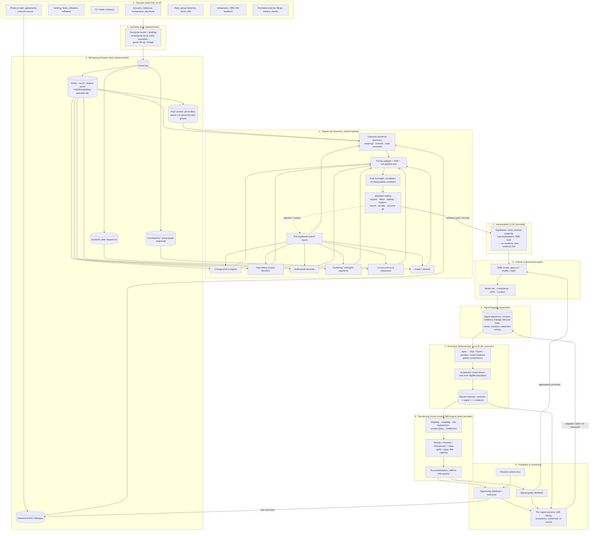
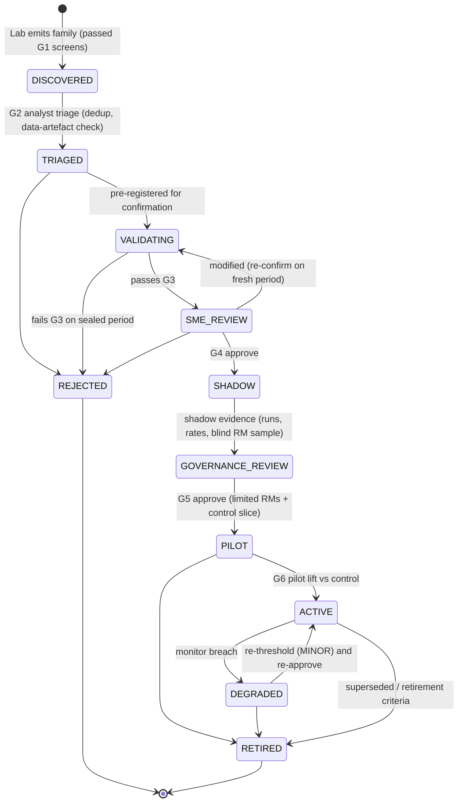

# Behavioural Signal Discovery — Critical Architecture Review, Recommendations and Method of Design

**Status:** review and design proposal. Nothing in this document is built
unless it says so, and it is marked when it is.
**Written:** 2026-09-23 · **Scope:** the "Signal Factory" brief (profile customer
data → discover patterns → hypothesise commercial meaning → validate →
govern → execute → rank → learn), reviewed against (a) this repository as
it stands on `Release1` @ `a80de51`, (b) named industry platforms, (c) the
academic methods literature and (d) UK model-risk / AI expectations.

**How to read the evidence in this document.** In line with `CLAUDE.md`,
every claim here is one of four kinds, and they are kept apart:

| Tag | Meaning |
|---|---|
| **[Repo]** | Checked in this repository during this review (file named). |
| **[Ref n]** | Taken from a primary or reference source in §20, and read during this review unless §20 says otherwise. |
| **[Judgement]** | The reviewer's engineering or analytical opinion. Challenge it. |
| **[Not found]** | Looked for and not located. Nothing is asserted about it. |

Companion docs: `docs/signal_discovery_design.md` (what the discovery
pipeline does today), `docs/HANDOFF_signal_discovery.md`,
`docs/architecture.md`, `docs/decision_record.md`.

---

## Contents

1. Executive summary — the verdict in twelve lines
2. What already exists in this repository, mapped to the brief
3. Critical architecture review (answers Q1, Q3, Q16)
4. Recommended architecture changes
5. Logical architecture diagram
6. The concept model: observation → … → next best action (Q7)
7. Behaviour representation and peer groups (Q3, Q4)
8. Statistical / ML techniques by discovery problem (Q2, Q5)
9. Who does what: deterministic vs ML vs LLM (Q9, Q10)
10. From candidate to executable logic (Q11)
11. Signal metadata and lifecycle (Q12)
12. Validation and governance framework (Q8)
13. False-discovery controls (Q6)
14. RM and SME feedback design (Q13)
15. Opportunity ranking (Q14)
16. POC design (Q17)
17. Industry comparison (Q15)
18. Regulatory and model-risk considerations
19. Differentiation, risks, and what the brief missed
20. References
Appendix A — Repository roadmap: concrete changes, in order
Appendix B — What was observed in the repository during this review

---

## 1. Executive summary

1. **The analogy with data-quality rule generation holds for the
   lifecycle and fails for validation.** Profile → suggest → approve →
   catalogue → execute continuously → monitor is a sound governance shape;
   Amazon Deequ's constraint suggestion is a direct precedent [Ref 40].
   It breaks down on validation. A DQ rule can be checked against a
   specification the data owner already holds. A commercial signal can only
   be confirmed by *future outcomes*, and those outcomes are rare, delayed,
   confounded by the bank's own actions, and non-stationary. **[Judgement]**
   A closer analogy is **quantitative factor research** ("the factor zoo"),
   where mining thousands of candidate predictors produced mostly false
   discoveries until multiple-testing hurdles were raised [Ref 60, 61].
2. **Pure unsupervised discovery will mostly find variance, not value.**
   **[Judgement]** The biggest missing idea is **outcome-anchored
   discovery**. A bank already holds historical *outcome events* without any
   RM feedback: product openings, facility drawdowns, FX or hedging take-up,
   limit increases, attrition. Asking "what behaviour reliably *precedes*
   these events, relative to matched non-events?" turns discovery into a
   testable, falsifiable problem. Unsupervised methods then earn their place
   as a *novelty* channel, not the primary one.
3. **The six-stage concept ladder (Observation → … → Opportunity) is
   right but incomplete.** It needs **Feature** (before Pattern), **Signal
   instance / trigger** (an active signal firing for one customer at one
   time), and a separate **Customer need** (latent, never observed). It also
   needs the decisioning concepts **Propensity**, **Uplift**,
   **Recommendation** and **Next best action** kept distinct (§6).
4. **Customer × Time × Feature is necessary but not sufficient.** Commercial
   banking's distinctive asset is the **counterparty payment network** and
   the **corporate group hierarchy**. Neither fits in a flat panel. The
   recommended representation has five layers: event log, entity-time panel,
   relationship graph, symbolic state sequences, and peer context (§7).
5. **The discovery engine is itself a model that produces models.**
   **[Judgement]** Under PRA SS1/23's broad definition of a model
   [Ref 31 ¶2.4], the practical way to scale governance is to **validate the
   factory once, rigorously** (Tier 1). Each signal it emits then passes a
   lighter, standardised gate. Validating each discovered signal from scratch
   does not scale, and waving them through is not defensible.
6. **False discovery is the central technical risk, not a detail.** The
   control must be structural: a pre-registered search space, a
   three-way temporal split with a sealed confirmation period, FDR control
   within hypothesis families, a **null-pipeline test** (run the whole
   factory on data with the structure destroyed; it must find ~nothing),
   near-duplicate collapse, and multi-period replication (§13).
7. **LLMs belong in exactly three places:** interpreting evidence into a
   named hypothesis with *mandatory rival explanations*; mapping a
   hypothesis to the product catalogue; and drafting SME- and RM-facing
   summaries. They never produce a number, choose a threshold, evaluate a
   customer or promote a signal (§9). The repository already follows this
   discipline **[Repo]** (`onboarding/signal_proposer.py`,
   `agents/domain_agent.py`).
8. **Signal strength and opportunity priority must be separate models.**
   Priority = eligibility and suitability gates, then
   *P(need | signals) × P(response | contact) × value*, later *uplift ×
   value*, under RM-capacity and contact-policy constraints (§15). This is
   close to Pega's P×C×V×L arbitration [Ref 9]. The difference is that
   signal evidence feeds *P(need)* rather than being multiplied in raw.
9. **What vendors provide:** Salesforce, Pega and SAS provide **execution and
   decisioning among known actions**. None of the material reviewed
   describes autonomous discovery of previously unspecified behavioural
   signals [Ref 5, 9–11, 16]. The closest is Pega Value Finder, which finds
   customers *under-served by existing actions* [Ref 11]. That is a
   coverage diagnostic, not signal discovery. **The genuinely new build is
   the Signal Lab (discovery + validation) and the governed Signal
   Registry.** Decisioning should be reused, not rebuilt.
10. **"Signal Factory" is a serviceable name with the wrong emphasis.**
    **[Judgement]** The constraint is validation throughput and SME
    attention, not generation volume. The recommended framing is
    **Signal Lab → Signal Registry → Decisioning**, i.e. research →
    catalogue → production, with a feature store underneath (§3.6).
11. **The smallest convincing POC has four arms, not three.** Control
    (rediscover cash build-up), Seeded (blind, sealed, grammar-generated
    patterns), Unknown (SME-judged), and **Null** (pure-structure-free data;
    the system must promote nothing). The claimed proof point needs one more
    clause: the approved signal's newly found customers must show the outcome
    at an elevated rate **against matched controls**, not merely "exist
    across the estate" (§16).
12. **This repository is a strong starting point.** It has the as-of
    discipline, sealed labels, a semantic layer, 5 archetypes, and a
    propose → accept → shadow boundary. It is missing a multi-window feature
    panel, peer groups, outcome events, FDR control, a sealed holdout, and
    signal-level metadata and lifecycle. Its stability test is too weak to
    reject anything (Appendix B). Appendix A orders the changes.

---

## 2. What already exists in this repository, mapped to the brief

**[Repo]** Observed during this review (details in Appendix B).

| Brief layer | Repository today | Assessment |
|---|---|---|
| 1 Semantic data understanding | `config/semantic_model.yaml`, `config/bindings/{fdm,legacy,sba}.yaml`, `datainsights/semantic/CanonicalSource`; `onboarding/propose` → review → `accept` (LLM-proposed bindings, human-gated) | **Strong.** Canonical concepts with `kind`, bi-temporal as-at collapse, three schemas through one pipeline. Missing: group hierarchy, counterparty entity, product catalogue as an ontology. |
| 2 Behaviour profiling / feature factory | `datainsights/features.py` (point-in-time `compute_many`, DuckDB pushdown for flat schemas); `onboarding/ml_profiler.py` (which measures are ML-eligible) | **Partial.** Features are computed per detector, not as a governed multi-window panel. No peer-relative features. |
| 3 Pattern discovery | `detection_engine/specs/archetypes.py` (5 archetypes); `onboarding/signal_enumerator.py` (archetype × canonical field × parameter grid) | **Template search only.** Can rediscover *shapes already known* (deviation, ratio, proximity, absence, ordinal migration) on new fields. Cannot find multivariate, cluster, sequence, network or peer-relative patterns. |
| 4 Hypothesis layer | `onboarding/signal_proposer.py` (local Ollama, 5-field structured output, category must exist in `config/categories.yaml`) | **Right discipline** (interpret, never compute). Missing: evidence citations, rival explanations, product mapping. |
| 5 Validation gate | `onboarding/signal_screener.py`: fires on 1–40% of the book, fire-rate swing ≤ 25 pts, Jaccard novelty < 0.60, as-of safe; co-occurrence lift | **Screens novelty, not validity.** No holdout, no multiple-testing control, no effect size, no outcome evidence. The stability test is nearly vacuous (Appendix B, finding B3). |
| 6 Signal registry | `config/domains_discovered.yaml` (`status: shadow`, provenance: archetype, screening stats, `accepted_by`); `domains_fdm.yaml` hand-authored and never tool-written | **Good safety boundary** (shadow signals cannot reach a worklist, test-enforced). Metadata is far short of §11. Lifecycle is a single state. |
| 7 Signal execution | Python detectors + pandas spec executor; `SqlSource`/`AthenaSource` conformance-tested through DuckDB; Snowflake **NOT RUN** | Recommendations 10–15 in `signal_discovery_design.md` (one spec, many executors) not built. |
| 8 Opportunity decisioning | `datainsights/correlation/` (one Recommendation per client, category, hypothesis, size, risk suppression); worklist ranks by indicative revenue then strength | Signal strength and priority are conflated. No propensity or uplift (correctly gated on labels, per `docs/gap_analysis.md`). |
| 9 Human feedback | `datainsights/rm_feedback.py`: Customer Engaged / Not Appropriate / Remind Me Later + sub-reason, per recommendation | Customer-level only. No signal-level feedback channel, no aggregation model. |
| 10 Monitoring and learning | `datainsights/runs.py`, `monitor.py`, `backtest.py` (replay as-of T + RM outcomes after T); `var/agent_traces.db` | Run plumbing exists. No per-signal monitors (drift, decay, acceptance, conversion vs control). |

**The honest one-line summary [Judgement]:** the repository has built the
*governance skeleton* of the brief well and early, but not yet its
*statistical core*. That is the right order to build in. The statistical
core is where the brief will succeed or fail.

---

## 3. Critical architecture review

### 3.1 Q1 — Is the DQ-profiling analogy technically sound? Where does it break?

**Where it holds.** Deequ profiles columns (completeness, distinct counts,
data types, value ranges) and *suggests* constraints for a human to accept
into a suite that then runs continuously [Ref 40, 41]. The brief proposes
the same lifecycle for behaviour, and it is the right *operating model*:
machine-suggested, human-approved, catalogued, versioned, continuously
executed and monitored.

**Where it breaks [Judgement]:**

| Dimension | DQ rule | Commercial signal | Consequence for design |
|---|---|---|---|
| Ground truth | Normative. The rule states what *should* be true, and a data owner can confirm it from the spec. | Empirical and latent. "This customer has an FX-hedging need" is never observed directly. | Validation needs *outcome proxies* and time. SME approval alone is opinion, not evidence. |
| Unit of analysis | Column or table population | Entity trajectory over time, relative to peers | Profiling has to be longitudinal and relative, not marginal. |
| Base rates | Violations are often common enough to see | Relevant commercial events are rare | Precision collapses unless effect sizes are large. Support floors matter. |
| Stationarity | Schema rules are stable | Behaviour shifts with rates, seasons and macro regimes | Signals decay. Retirement is a first-class lifecycle state. |
| Feedback contamination | Running a DQ rule does not change the data | RM contact changes outcomes, and only contacted customers produce labels | You need control groups and exploration, or you learn your own targeting policy [Ref 72]. |
| Search multiplicity | A modest rule set per column | Features × windows × peers × thresholds × combinations run into thousands or more | Multiple-testing control is structural (§13). |
| Cost of a wrong rule | A false alert to a data steward | Wasted RM time, eroded trust, possible conduct or fairness exposure | Governance weight is closer to model risk than to DQ. |
| Explainability | Self-explaining ("column X not null") | Needs a business story that is *true*, not just plausible | Rival explanations are required; an LLM makes plausibility cheap. |

**Better analogies to borrow from:**

- **Quantitative factor research.** Hundreds of published return
  predictors turned out to be largely false discoveries until
  multiple-testing hurdles were raised (e.g. t > 3.0 rather than 2.0)
  [Ref 60]. Backtest overfitting has formal corrections, such as the
  deflated Sharpe ratio [Ref 61].
- **Drug discovery screens:** screen → hit → lead → trial, with *most
  hits expected to fail* and escalating evidence at each stage.

Both teach the same thing: generation is cheap, and the value is in the
funnel of increasingly expensive validation.

### 3.2 Structural weaknesses in the proposed architecture

**[Judgement]** Ranked by impact.

1. **No first-class outcome layer.** Outcomes appear only at step 10 as
   "feedback". They should be a *foundation* input: a governed catalogue of
   historical outcome events (product/agreement openings, drawdowns,
   hedging trades, limit changes, attrition, arrears), derived
   point-in-time from existing product-holding data. Without it,
   "statistically validate" has nothing to validate against. In this repo
   the FDM contract already carries `party_agreement` and `agreement` with
   effective dates **[Repo]** (`config/entities_fdm.yaml`), so *new
   agreement* events are derivable. The repo's position that "there are no
   outcome labels" (`signal_discovery_design.md`) is true for RM responses
   but not for product adoption.
2. **Unsupervised-first ordering.** Clustering and anomaly detection
   optimise for statistical unusualness. Unusual ≠ commercially relevant,
   and the SME queue will fill with data-quality artefacts, one-off
   transactions and seasonal effects. Put outcome-anchored discovery
   first. Use unsupervised methods for novelty, then *test their candidates
   against outcomes*.
3. **Wrong customer grain for commercial banking.** Customer-level
   profiling ignores group structures (parent/subsidiary, common
   ownership), multi-account relationships, and the fact that the *RM
   relationship* is the unit of action. A subsidiary's cash build-up can be
   a group treasury sweep, not a need.
4. **No network view.** Supplier and buyer payment networks are the most
   commercially distinctive data a commercial bank holds. They yield
   signals no peer bank or vendor can replicate: new suppliers in new
   currencies, supply-chain concentration, counterparties who are
   themselves prospects, and contagion of a counterparty's distress.
5. **Seasonality and regime shifts are not in the design.** Own-history
   deviation without seasonal adjustment will flag every agricultural or
   retail client every quarter. Rate or FX shocks make the *whole
   population* anomalous at once. Features need seasonal decomposition
   [Ref 50] and population- or peer-relative normalisation.
6. **"Validated signal" conflates statistical and commercial validation.**
   These need different evidence and different owners (§12). A pattern can
   be statistically robust and commercially useless (e.g. "clients paying
   payroll pay payroll monthly"). It can also be commercially compelling
   and statistically unstable.
7. **The final proof statement proves too little.** "…the approved signal
   identified additional eligible customers across the estate" is true of
   *any* rule. The proof needs a forward or backtested outcome lift against
   matched controls (§16).
8. **Data-protection and conduct gates are missing.** Profiling sole
   traders and partnerships processes personal data. That brings a DPIA,
   lawful basis and purpose compatibility into play [Ref 37]. Some small
   businesses are retail customers for certain regulated products, where
   Consumer Duty outcomes apply [Ref 38] (scope to be confirmed with
   Compliance).

### 3.3 Q3 — Should behaviour be represented differently?

Yes, in layers. See §7.

### 3.4 What the brief gets right and should keep

- The strict separation of evidence (deterministic) from interpretation
  (LLM) from approval (human).
- Compilation of approved signals to deterministic, versioned execution,
  with no LLM in the per-customer loop.
- Signal strength ≠ opportunity priority. Uplift as a later stage.
- Two-level feedback, with no single-RM promotion.
- An explicit lifecycle, including *degraded* and *retired*.
- The warning against PCA components as RM-facing signals, consistent with
  the argument for inherently interpretable models in high-stakes settings
  [Ref 58].

### 3.5 Where the brief is over-scoped for a first delivery

**[Judgement]** Ten method families, a full registry, uplift, and
continuous learning add up to a multi-year programme. For the first
delivery, the evidence argues for:

- two discovery channels: outcome-anchored subgroup/contrast discovery,
  plus change-point and peer-deviation screening;
- one governed registry;
- reuse of the existing decisioning platform.

Clustering, sequence mining and graph discovery come next, and each must
earn its place by producing validated signals the first channels missed.

### 3.6 Q16 — Is "Signal Factory" the right abstraction?

**[Judgement]** It is adequate as an internal label, but it points at the
wrong constraint. A factory optimises throughput of generated items, while
this system's bottleneck is **validated** items per unit of SME and
validation effort. The industry-recognisable decomposition is:

| Component | Industry pattern | Analogues |
|---|---|---|
| **Behavioural Feature Store** | Point-in-time feature store / semantic layer | Feature stores, Data Cloud calculated insights [Ref 5] |
| **Signal Lab** | Research environment with a pre-registered search, sealed holdout, experiment tracking | Quant alpha research [Ref 60, 61]; screening pipelines |
| **Signal Registry** | Model inventory + rule catalogue + data-product contract | SS1/23 model inventory [Ref 31 ¶1.2]; Deequ suites [Ref 40]; SAS decision governance [Ref 16] |
| **Decisioning** | NBA arbitration among *known* actions | Pega CDH [Ref 9, 10], SAS Intelligent Decisioning [Ref 16], Salesforce NBA [Ref 7] |
| **Learning loop** | Outcome capture, controls, monitoring, retraining | Pega adaptive models [Ref 10]; CBA's live experiments [Ref 14] |

The name should make clear that the Lab's output is a **hypothesis with
evidence**, and the Registry's is a **governed, executable asset**.

---

## 4. Recommended architecture changes

In priority order. **[Judgement]**, with the repository hook shown where one
exists.

| # | Change | Why | Repo hook |
|---|---|---|---|
| C1 | Add an **Outcome Event Catalogue**: point-in-time product adoption, drawdown, hedging, attrition and arrears events derived from holdings | Makes discovery falsifiable before any RM feedback exists | `party_agreement`/`agreement` effective dates; `datainsights/backtest.py` |
| C2 | Make **outcome-anchored discovery** the primary channel (subgroup discovery, contrast sets, case-crossover); unsupervised methods become the novelty channel | Finds value, not variance | new `onboarding/signal_outcome_screen.py` |
| C3 | Build a **governed multi-window feature panel** (entity × as-of × feature, windows 7/30/90/180/365, seasonally adjusted, peer-relative) | One vocabulary for discovery, execution and explanation | extend `datainsights/features.py` |
| C4 | Add a **Peer Group Registry** (versioned definitions, minimum sizes, back-off hierarchy) | Peer deviation is meaningless without governed peers | new `config/peer_groups.yaml` |
| C5 | Add **group hierarchy and counterparty graph** layers | Commercial grain; unique signal source | semantic model concepts `group_id`, `counterparty_id` |
| C6 | **Pre-registered search + three-way temporal split + sealed confirmation period + FDR by family + null-pipeline test** | False discovery is the central risk | `signal_screener.py`; `protected_evaluator_only/` pattern |
| C7 | Collapse near-duplicate candidates into **signal families** before review | SME attention is the bottleneck | the 3 shadow signals in `domains_discovered.yaml` are one family |
| C8 | **Full signal metadata + multi-state lifecycle** with gate criteria and owners | Governance, SS1/23 inventory | extend `domains_discovered.yaml` → registry |
| C9 | **Validate the factory** (Tier 1) and standardise the per-signal gate | Governance that scales | new validation pack (§12) |
| C10 | LLM output adds **evidence references, rival explanations, product mapping**; numbers are forbidden in free text | Hallucination containment | `signal_proposer.py` schema |
| C11 | One declarative **signal spec → multiple executors** (pandas / SQL / Spark), golden conformance | Reproducibility and scale | recs 10–15 in `signal_discovery_design.md` |
| C12 | **Separate strength from priority**; add eligibility/suitability gates and RM-capacity constraint | Priority is a decision, not a signal property | `datainsights/fdm_worklist.py` ranking |
| C13 | **Two-channel feedback** with reason codes and aggregation; **random control slice** from day one | Unbiased learning | `datainsights/rm_feedback.py` |
| C14 | **Per-signal monitoring** (trigger-rate control charts, input drift, acceptance, conversion vs control, decay) and retirement rules | Signals decay | `datainsights/monitor.py` |
| C15 | DPIA / Consumer-Duty / fairness gate in the lifecycle | Missing regulatory gate | lifecycle state `GOVERNANCE_APPROVED` |

---

## 5. Logical architecture diagram



Reading rules:

- Numbers flow only from L2/L3/L7, all deterministic or statistical.
- The LLM (L4) receives evidence *by reference* and returns text plus
  references.
- Nothing moves from L3 to L7 without passing L5 and being written to L6.
- Feedback (L9) changes *ranking* quickly, and changes *signal status* only
  through L5.

---

## 6. The concept model (Q7)

The brief's six concepts, extended to fourteen so that no two are
confused. The **[Repo]** column shows how the existing codebase names each
one; note that the repo's `Signal` dataclass is what this document calls a
*signal instance*.

| # | Concept | Definition | Produced by | Example | Repo today |
|---|---|---|---|---|---|
| 1 | **Observation** | A recorded fact at a point in time | Source systems | £48k credit from counterparty X on 2026-06-03 | rows via `CanonicalSource` |
| 2 | **Feature** | A deterministic, point-in-time aggregate of observations for an entity | Feature store | 90-day mean end-of-day balance; share of EUR outflows | `features.py` (partial) |
| 3 | **Pattern** | A statistically notable relationship, deviation, change, cluster, sequence or subgroup *in the population*, with measured support and effect | Signal Lab | Segment where 90d EUR inflow growth > 40% and new foreign counterparties ≥ 3 has 3.1× FX-product adoption within 120 days | none (screen outputs are close) |
| 4 | **Candidate signal (hypothesis)** | A pattern + a proposed commercial meaning + rival explanations; unvalidated | LLM + analyst | "Emerging FX exposure" | `domains_discovered.yaml` entries |
| 5 | **Validated signal** | Candidate that passed statistical gates *and* SME commercial review | Lab + SME | as above, v0.3, SME-approved | none |
| 6 | **Active signal** | Validated signal that passed governance and is deployed with monitors | Registry | status ACTIVE | `domains_fdm.yaml` (hand-authored) |
| 7 | **Signal instance (trigger)** | An active signal evaluating true for one entity at one as-of time, with its evidence values | Execution | Client 123 triggered FX-exposure v1.2 on 2026-09-20 | `detection_engine.signal.Signal` |
| 8 | **Customer need** | The latent state the hypothesis claims; never observed, only inferred | Inference, confirmed by conversation | Client 123 has unmanaged EUR exposure | not modelled (correct) |
| 9 | **Opportunity** | Signal instance(s) + eligibility + suitability + whitespace (doesn't already hold the product) + no suppression | Decisioning gates | Client 123 eligible for FX forward, not held | `Recommendation` before ranking |
| 10 | **Propensity** | P(positive response \| customer, action, context) | Supervised model | 0.18 | `UnavailablePropensityModel` (gated) |
| 11 | **Uplift** | P(response \| treated) − P(response \| not treated) | Causal / uplift model | +0.06 | not started |
| 12 | **Expected value** | Uplift (or propensity) × value − cost | Decisioning | £2.1k | indicative revenue (sizing only) |
| 13 | **Recommendation** | A ranked opportunity with action, rationale and evidence, presented to an RM | Decisioning + narration | row in worklist | `Recommendation` + narrative |
| 14 | **Next best action** | The single action chosen after arbitration across all recommendations for the entity, *including "do nothing"*, subject to contact policy and RM capacity | Arbitration | "Call about FX hedging this week; defer deposit sweep" | one recommendation per client (close) |

Plus **Outcome** (what actually happened: contacted, interested,
declined, converted, value). It is recorded against the instance and the
recommendation, never against the signal directly.

**Rule of thumb [Judgement]:**

- Concepts 1–3 are about the *data*.
- 4–6 are about *knowledge* (governed, versioned).
- 7–9 are about *a customer now*.
- 10–14 are about *a decision*.

A component that crosses those bands is a design smell. For example, an
LLM that reads a customer's data and decides whether they "have a need".

---

## 7. Behaviour representation and peer groups (Q3, Q4)

### 7.1 Five representational layers

**[Judgement]** The panel is the working surface, but on its own it loses
three things commercial discovery needs: exact event timing, network
structure and ordered sequences.

| Layer | Shape | What it is for | Notes |
|---|---|---|---|
| **Event log** | (entity, event_type, amount, currency, counterparty, product, valid_time, knowledge_time) | Source of truth; exact timing; case-crossover designs | Bi-temporal: *knowledge time* stops look-ahead leakage when data arrives late. The repo's as-of discipline generalises here. |
| **Entity × as-of × feature panel** | Wide, sparse, point-in-time | Most discovery methods; execution; explanation | Grain: legal entity, rolled up to group and RM relationship. As-of dates weekly or monthly; windows 7/30/90/180/365. Includes YoY-same-period features for seasonality. |
| **Relationship graph** | Snapshots of customer–counterparty–product–RM edges with weights | Network signals (§8) | Counterparty resolution is a sizeable data problem in its own right; start with top-N counterparties by value. |
| **Symbolic state sequences** | Per entity per period, a small alphabet of *states* (e.g. `CASH↑`, `UTIL↓`, `FX_NEW_CCY`) | Sequence mining; **RM-legible narratives** | States are defined from governed features and thresholds. This is the explainability bridge for temporal patterns (cf. SAX symbolisation [Ref 84]). |
| **Peer context** | For each (entity, as-of, feature): peer percentile, robust z vs peer, and own-history robust z | Relative deviation; the 2×2 "unusual vs self / vs peers" | Computed against a *versioned* peer definition. |

**Feature families to govern** (so FDR can be applied per family, §13):
level, trend/growth, acceleration, volatility, frequency/recency,
inflow/outflow balance, utilisation/headroom, currency mix, counterparty
count/novelty/concentration (HHI), geography, seasonality residual,
self-deviation, peer-deviation.

### 7.2 Peer-group construction

**[Judgement]** A peer group is a governed analytical asset with a
version, owner and monitored stability, not a join.

1. **Define peers on structural attributes, never on the behaviour being
   tested.** Sector (UK SIC 2007 at 2- then 1-digit), size band (turnover
   or employees from filings or KYC, *not* balances, which are
   behaviour), region, business age, and legal form. Peers defined on
   balances make "unusual balance vs peers" circular.
2. **Use a hierarchical back-off with a minimum size.** Try SIC-4 × size ×
   region first. If n < 30 (tunable), back off to SIC-2 × size, then SIC-1
   × size, then size only. Record the level used on every peer-relative
   value, so an RM can see "compared with 214 UK food manufacturers,
   £5–25m turnover".
3. **Shrink small-group statistics.** Use empirical-Bayes shrinkage of peer
   medians and dispersions toward the parent level, so a 31-member group's
   noisy median does not manufacture outliers [Ref 59].
4. **Use robust statistics.** Median/MAD and percentile ranks, not
   mean/SD. Commercial amounts are heavy-tailed. The repo's
   `large_incoming_payment` MAD approach generalises here **[Repo]**.
5. **Treat sector codes as a challenge.** Registered SIC codes are often
   stale or wrong. Build a *behavioural* sector challenger from the payment
   network (who you pay and who pays you). Where it disagrees with the
   registered code, that disagreement is itself a candidate signal
   (business-model change).
6. **Behavioural peers as a second lens only.** Clustering on slow-moving
   structural behaviour (e.g. 12-month product mix, payment-cycle shape)
   can form "behavioural cohorts". Keep these separate from structural
   peers and never cluster on the feature under test.
7. **Monitor peer stability.** Track group membership churn and median
   drift per version. A peer-group redefinition is a *major* version change
   for every signal that uses it (§11).
8. **Watch for Simpson's paradox.** Validate every peer-relative signal
   within strata (size band, region), not just pooled (§12).
9. **Watch for fairness proxies.** For sole traders and partnerships,
   geography and sector can proxy protected characteristics. Include peer
   definitions in the fairness review (§18).

**Deviation grid shown to RMs:**

| | Normal vs peers | Unusual vs peers |
|---|---|---|
| **Normal vs own history** | nothing | structural difference (a *segment* fact, not a trigger) |
| **Unusual vs own history** | a change for this client that is normal for peers (may be sector-wide, e.g. a season or rate move) | **strongest trigger candidate** |

---

## 8. Statistical / ML techniques by discovery problem (Q2, Q5)

### 8.1 Technique map

Each technique answers **one** question. Rows marked ★ are *not in the
brief*.

| Discovery question | Techniques | Output that is RM-explainable | Maturity for POC | Refs |
|---|---|---|---|---|
| ★ **What behaviour precedes known outcomes more often than in comparable non-outcomes?** | **Subgroup discovery** (WRAcc / lift quality, beam search); **contrast-set / emerging-pattern mining**; **case-crossover** (the entity is its own control: the window before the event vs earlier reference windows); matched case-control | A conjunction of ≤3 feature conditions + lift + support | **High, first channel** | [Ref 51, 52, 53, 54] |
| Has an entity's behaviour entered a new regime? | PELT, binary segmentation, window-based, kernel CPD; **Bayesian online CPD** for streaming | "Balance regime moved from ~£1.2m to ~£2.0m on 14 Jul; persisted 9 weeks" | High | [Ref 42, 43, 44] |
| ★ Is the change just seasonality? | STL decomposition; YoY same-period deltas; calendar/holiday effects | "Up 38% vs the same 8 weeks last year" | High (pre-processing, mandatory) | [Ref 50] |
| Is current behaviour unusual vs own history or peers (univariate)? | Robust z (median/MAD), peer percentiles, empirical-Bayes shrinkage | "96th percentile among 214 peers" | High | [Ref 59] |
| Is multivariate behaviour unusual? | Isolation Forest, LOF, robust Mahalanobis (MCD); **conformal** calibration of anomaly scores | Top-k per-feature contributions (SHAP / robust-z decomposition), then a rule surrogate | Medium (explore, then compile) | [Ref 45, 46, 55, 56] |
| Are new behavioural groups emerging? | HDBSCAN (noise allowed, no k); hierarchical; K-Means only for sizing; **cluster-transition tracking** over time | Cluster described by its distinguishing features (contrast vs rest) | Medium | [Ref 47, 48] |
| Which behaviours co-occur? | Apriori / FP-growth on *symbolic states*; lift with significance (Webb's approach) | "CASH↑ ∧ UTIL↓ ∧ NEW_SUPPLIER" | Medium | [Ref 62, 63, 52] |
| Which *sequences* precede events? | PrefixSpan / SPADE on state sequences; ★ **survival / hazard models** (time-to-event given a state) | "CASH↑ → UTIL↓ within 60d → treasury engagement; hazard ×2.4" | Medium | [Ref 64, 65, 66] |
| ★ Recurring shapes / motifs in a series | Matrix profile (motif & discord discovery) | "Same 4-week pattern repeated before each large outflow" | Exploratory | [Ref 57] |
| Nonlinear dependencies | Spearman, mutual information (KSG estimator), conditional MI | Dependency map for analysts, **not RM-facing** | Exploratory | [Ref 67] |
| Dimensionality reduction | PCA, autoencoders | Never RM-facing (agrees with brief) | Pre-processing only | — |
| ★ **Network / graph** | New-edge / new-counterparty detection; counterparty concentration; community detection (Leiden); centrality change; supply-chain exposure propagation; later link prediction | "3 new EUR suppliers in 60 days, 2 in Germany" | Medium (data-hungry) | [Ref 68] |
| ★ **Causal / effect** | Event study / diff-in-diff; synthetic control; double ML; causal forests for heterogeneity | "Clients who got treasury contact after trigger converted +6 pts vs matched" | Later (needs treatment data) | [Ref 69, 70, 71] |
| Propensity (supervised, known outcome) | Gradient boosting with monotonic constraints; logistic/GAM for challenger; calibrated | Reason codes | When outcome volume allows | — |
| Uplift | Two-model / T-/X-learner, uplift trees | Incremental effect, not RM-facing directly | Later (needs randomised control slice) | [Ref 71, 73] |
| ★ **Rule extraction from any detector** | RuleFit, SIRUS, decision-tree surrogate with fidelity check | "IF a AND b AND c" | High (the compilation step) | [Ref 58, 74] |
| ★ **Feature relevance with FDR** | FRESH (per-feature hypothesis tests + Benjamini–Yekutieli); knockoffs; stability selection | Which features matter for an outcome | High | [Ref 75, 76, 77] |
| ★ Weak supervision | Treat each active signal as a *labelling function*; combine noisy labels (Snorkel-style) to bootstrap a need model | — | Later | [Ref 78] |
| ★ Positive-unlabelled learning | RM "converted" = positive; everyone else is *unlabelled*, not negative | — | When feedback flows | [Ref 79] |

### 8.2 Q5 — Multivariate and temporal detection without losing RMs

**[Judgement]** Detect with whatever works, and **ship only what can be
said in one sentence**.

1. **Discover complex, deploy simple.** Any multivariate or temporal
   finding must be **compiled into a rule surrogate** before it goes to an
   SME: at most three conditions over governed features, each with a
   threshold. Record the surrogate's *fidelity* to the discovering model
   (agreement on the flagged population). If fidelity is below the
   threshold (e.g. Jaccard < 0.7), the finding stays in the Lab. Validation
   is performed on the surrogate, which is what will actually run.
2. **Sparse explanations.** For anomaly scores, report the top 3
   contributing features with direction and magnitude (SHAP [Ref 55] or
   additive robust-z decomposition). Never show a raw anomaly score.
3. **Symbolic sequences.** Temporal findings are stated as ordered states
   with time gaps ("cash up → utilisation down within 60 days"). The
   states are named in the registry with their threshold definitions.
4. **Persistence requirement.** A trigger must persist for *k* consecutive
   periods (the brief's "persists 60 days"). This suppresses one-off
   spikes and makes the trigger defensible.
5. **Fixed explanation template per signal.** The RM sees, in order: what
   changed (feature, from → to, over when); compared with whom (own
   history, peers); why it may matter (the approved hypothesis); what else
   it could be (the approved rival explanations); what to do (the action).
   Numbers are slot-filled from the signal instance's evidence, never
   written by an LLM (this is how `agents/domain_agent.py` already
   validates narratives **[Repo]**).

---

## 9. Who does what: deterministic vs ML vs LLM (Q9, Q10)

### 9.1 Allocation

| Function | Deterministic / statistical | ML | LLM / agent | Human |
|---|---|---|---|---|
| Schema understanding, binding | profiling stats, type checks | — | **propose** mappings | **accept** (repo does this) |
| Entity resolution, group roll-up | rules + match scores | similarity models (optional) | — | adjudicate ambiguous |
| Feature computation | **all** | — | — | approve feature definitions |
| Peer groups | **all** (definitions, shrinkage) | clustering for behavioural cohorts | — | approve definitions |
| Pattern discovery | CPD, robust stats, subgroup, FDR | IF/LOF/HDBSCAN, surrogates | — | — |
| Search-space definition | — | — | *suggest* feature families to add | **pre-register** |
| Candidate naming, hypothesis | — | — | **yes** (bounded) | edit |
| Rival explanations | data-quality checks produce candidates | — | **draft** (mandatory field) | confirm |
| Product mapping | catalogue lookup | — | **propose** (restricted to catalogue IDs) | confirm |
| Statistical validation | **all** | — | — | review |
| Commercial validation | — | — | summarise evidence for SMEs | **decide** |
| Promotion to ACTIVE | registry checks | — | — | **governance decision** |
| Execution per customer | **all** (compiled spec) | model scoring for ML signals | **never** | — |
| Eligibility / suitability / suppression | **all** | — | — | policy owners |
| Priority | arithmetic, constraints | propensity, uplift | — | set business levers |
| RM narrative | slot values | — | **wording only** of validated facts | RM reads |
| RM Q&A copilot | retrieves the row's evidence | — | answers *from that row only* (repo A3) | — |
| Feedback aggregation | **all** | label-noise models | summarise free text into reason codes (suggest) | — |
| Monitoring, retirement | **all** | drift detectors | draft monitoring narrative | **decide** retirement |

### 9.2 Q10 — Containing LLM hallucination

**[Judgement]** Layered, with each layer independently testable.

1. **No numbers from the model.** Evidence is passed as a table with row
   IDs. The output schema has *no numeric fields*, and free text is scanned:
   any digit sequence not traceable to a supplied evidence value is a
   validation failure. The repo already checks numeric consistency on
   narratives **[Repo]** (`docs/current_state.md`, Narrative).
2. **Closed vocabularies.** Category, product and signal-family fields are
   enums from the registry. An out-of-vocabulary value is *rejected*, not
   coerced (the repo does exactly this for categories **[Repo]**).
3. **Mandatory citations.** Every sentence of the hypothesis must reference
   ≥1 evidence ID, and a deterministic verifier checks that the references
   exist and that the direction matches (↑/↓). The repo's
   `_direction_problem` pattern **[Repo]** generalises here.
4. **Mandatory rival explanations** (≥2), from a fixed taxonomy: data
   artefact, seasonality, one-off event, group/intra-company movement,
   macro/sector-wide move, product migration, and *genuine need*. This
   counters the LLM's tendency to produce one fluent, persuasive story that
   anchors SMEs.
5. **Retrieval restricted to an approved corpus** (product catalogue,
   signal registry, glossary, the semantic model). No open web.
6. **Show evidence first, hypothesis second.** SMEs see numbers and the
   rule before the LLM's story, which reduces anchoring **[Judgement]**.
7. **Self-consistency.** Sample *n* times. If the category or product
   mapping disagrees across samples, flag "unstable interpretation" to the
   SME rather than picking one.
8. **Blind to protected data.** The LLM never sees holdout periods, sealed
   seeded-pattern definitions, or outcome labels for the confirmation
   period. The repo enforces the equivalent for ground truth **[Repo]**
   (`CLAUDE.md`, `OfflineLocalSource`).
9. **Measured, not assumed.** Keep a hallucination test set of evidence
   packs with known-correct interpretations, re-run it on every model or
   prompt change, and version prompts (the repo hashes prompts **[Repo]**,
   `prompts/hashes.json`). Note the repo's own finding that model choice
   determined structured-output reliability (qwen2.5 0/4, llama3.1 4/4)
   **[Repo]**. This is a governed dependency, not a detail.
10. **The LLM is a tool in development, not a decision-maker.** It still
    belongs in the model inventory as a component of the Lab (§18).

---

## 10. From candidate to executable logic (Q11)

**[Judgement]** Compile, don't generate. The repo has already rejected
"LLM generates detector code" as unauditable **[Repo]**
(`signal_discovery_design.md`, rejected options), and that decision is
right.

**Pipeline:**

```
Surrogate rule / model (Lab)
   │  expressed as
   ▼
Declarative Signal Spec (YAML, schema-validated)        ← the governed artefact
   archetype | canonical features (by registry ID + version) | windows
   thresholds | persistence k | population filter | peer-group ref+version
   exclusions | evidence fields (raw_measure contract) | cooldown
   │  compiled by
   ▼
Intermediate representation (relational algebra over the feature panel)
   │  emitted to
   ├── pandas / DuckDB  (Lab, tests)        ← exists today [Repo]
   ├── SQL (Snowflake / Athena / Postgres)  ← recs 10-15, not built
   ├── Spark (Glue / EMR)
   └── model endpoint (for ML signals: versioned artefact + scoring contract)
   │  proven by
   ▼
Golden conformance suite: identical flagged set AND identical evidence values
(the raw_measure surface) across executors on fixed fixtures [Repo precedent:
tests/test_sql_source_conformance.py]
```

**Rules:**

- Signals reference **features by ID and version**, never raw columns. A
  feature-definition change fans out as a version bump to every dependent
  signal.
- Composite signals are DAGs of signal references with boolean or temporal
  operators (`A AND B within 30d`). They are the governed form of the
  repo's `combinations:` table.
- ML signals ship as a *model artefact* plus a threshold in the spec. The
  spec, not the model, owns the trigger decision.
- Executors are chosen by a planner from spec properties (pushdown-able or
  not, exact or approximate median), as the repo's own design notes
  propose **[Repo]**.
- **Implementation option [Judgement]:** a dataframe-to-SQL layer that
  targets several engines (e.g. Ibis) or a SQL transpiler (e.g. SQLGlot)
  avoids hand-writing one compiler per dialect. Evaluate one against the
  existing DuckDB conformance approach before committing.

---

## 11. Signal metadata and lifecycle (Q12)

### 11.1 Registry record (proposed schema)

```yaml
signal_id: SIG-FX-EXPOSURE-EMERGING
version: 1.2.0              # MAJOR.MINOR.PATCH, rules below
name: Emerging FX exposure
family: fx_exposure          # near-duplicate candidates collapse into a family
type: composite              # deterministic | statistical | ml | composite
status: ACTIVE               # lifecycle state, §11.2
hypothesis: >
  Sustained growth in foreign-currency flows and new international
  counterparties may indicate unmanaged currency exposure.
rival_explanations:          # approved by SME; shown to RMs
  - group_treasury_sweep
  - one_off_contract
customer_need: currency_risk_management
products: [FX_FORWARD, FX_OPTION, MULTI_CCY_ACCOUNT]   # catalogue IDs
population:
  include: "segment in (MID_CORP, SME_UPPER) and active_months >= 12"
  exclude: [risk_suppressed, fincrime_restricted, in_collections]
peer_group: {ref: PG-SIC2-SIZE-REGION, version: 3}
inputs:                      # features by ID@version; lineage resolves to sources
  - F-FX-OUTFLOW-GROWTH-90D@2
  - F-EUR-INFLOW-GROWTH-90D@2
  - F-NEW-INTL-CPTY-COUNT-60D@1
logic: {spec_ref: specs/fx_exposure_emerging.yaml, sha256: "…"}
execution: {executors: [sql_snowflake, pandas], planner: pushdown, schedule: weekly}
persistence_periods: 2
cooldown_days: 90
evidence_fields: [fx_outflow_growth, eur_inflow_growth, new_intl_cpty, peer_pct]
discovery:
  channel: outcome_anchored_subgroup
  search_registration: SR-2026-10-01      # pre-registered search space
  discovery_period: 2023-01..2024-12
  validation_period: 2025-01..2025-09
  confirmation_period: 2025-10..2026-03   # sealed until gate G3
statistics:
  support_confirm: 482
  outcome: {event: FX_PRODUCT_OPEN_120D, lift_confirm: 3.1, ci95: [2.4, 3.9]}
  fdr_family: fx_flows, q: 0.10, adjusted_p: 0.004
  stability: {periods_replicated: 4, of: 5}
  cohort_consistency: {strata: size_band x region, direction_consistent: 11/12}
  null_pipeline_rate: 0.00
  surrogate_fidelity: 0.86
materiality_tier: 3          # SS1/23-style tiering (§18)
owner: {business: "Head of FX Sales, C&I", technical: "Signal Lab lead"}
approvals:
  - {gate: G4_SME, by: "...", date: 2026-04-02, decision: approve_with_changes}
  - {gate: G5_GOV, by: "Model Risk", date: 2026-04-20, conditions: ["monitor fairness by region"]}
monitoring:
  trigger_rate: {expected: [0.02, 0.05], control_chart: p_chart}
  input_drift: {metric: PSI, alert: 0.2}
  rm_acceptance_min: 0.25
  conversion_vs_control_min_lift: 1.5
activation_date: 2026-05-01
review_date: 2026-11-01
retirement_criteria:
  - "conversion lift vs control < 1.2 for 2 consecutive quarters"
  - "trigger rate outside expected band for 3 consecutive runs without explanation"
  - "superseded by family member with higher validated lift"
lineage: {openlineage_job: signal.fx_exposure_emerging, code_version: git:…}
```

### 11.2 Lifecycle



Differences from the brief's lifecycle, and why **[Judgement]**:

- **SHADOW** before governance: the signal runs on live data, invisible
  to RMs, to produce operational evidence (trigger rates, stability, and a
  blind sample reviewed by RMs). The repo already implements this state
  **[Repo]**.
- **PILOT** with a randomised control slice before ACTIVE. This is the
  first point at which *causal* evidence exists.
- **REJECTED** is retained with a reason, and fed back to the search
  registry so the same hypothesis is not re-proposed each cycle.

### 11.3 Versioning rules

| Change | Version | Re-validation |
|---|---|---|
| Code refactor or executor port, identical output on golden set | PATCH | conformance tests only |
| Threshold within the SME-approved band; cooldown change | MINOR | stability re-check on the latest period |
| New or changed feature, window, population, peer-group version, logic | MAJOR | back to VALIDATING |
| Hypothesis or product mapping change | MAJOR | SME + governance |

---

## 12. Validation and governance framework (Q8)

### 12.1 Gates and mandatory evidence

| Gate | Owner | Mandatory evidence (all must pass) | Default thresholds (tune) |
|---|---|---|---|
| **G1 Screen** (automatic) | Lab | Support ≥ N; effect size ≥ floor; as-of safe; seasonally adjusted; not a data artefact (no dependency on null/default/sentinel values; DQ checks pass on inputs) | N ≥ 50 entities *and* ≥ 0.5% of eligible population; standardised effect ≥ 0.5 or lift ≥ 1.5 |
| **G2 Triage** | Analyst | Family collapse done; novelty vs registry (flagged-set Jaccard < 0.6 *and* not the same feature family + direction); plausible action exists | — |
| **G3 Statistical confirmation** (sealed period) | Lab + independent reviewer | Pre-registered hypothesis replicates on the sealed confirmation period; FDR-controlled within family; replication in ≥ k of m periods; direction-consistent across strata (size, region, sector); null-pipeline rate ≈ 0; surrogate fidelity ≥ threshold; **outcome lift vs matched controls where an outcome exists** | q = 0.10; k/m = 3/4; strata consistency ≥ 80%; lift CI lower bound > 1.2 |
| **G4 Commercial (SME)** | Product + RM SMEs (≥ 3, independent) | Hypothesis plausible; rival explanations reviewed; action and product mapping sensible; customer-level explanation understood from ≥ 10 sampled instances | Majority approve; dissent recorded |
| **G5 Governance** | Model Risk, Compliance, Data Protection | Tier assigned; DPIA / purpose check; fairness check across relevant groups; Consumer-Duty applicability decided; monitoring plan; owner named | per policy |
| **G6 Pilot** | Business + Lab | Randomised or matched control; conversion or engagement lift vs control; RM acceptance ≥ floor; no adverse conduct signals | pre-registered pilot metric |

**Not mandatory, but required for Tier 1–2 signals:** a causal estimate
(diff-in-diff or synthetic control) and independent re-implementation of
the spec.

### 12.2 Governing the factory (meta-validation)

**[Judgement]** Validate the *process* that produces signals, once, at
Tier 1, and re-validate on material change. That covers the search
registration, feature store, peer groups, discovery algorithms, FDR
procedure, surrogate compiler, executors and LLM proposer.

Evidence for the process:

- **Seeded-pattern recall.** Blind, grammar-generated patterns injected
  into data the Lab has not seen. Recall@K across multiple seeds.
- **Null false-discovery rate.** The pipeline run end to end on
  structure-destroyed data (within-entity time permutation; cross-entity
  label permutation) must promote ≈ 0 signals past G3.
- **Control rediscovery.** Known signals (e.g. cash build-up) are
  rediscovered from outcomes or unsupervised channels without being
  specified.
- **Reproducibility.** Same inputs + same registration → identical
  candidate set.
- **Executor conformance.**
- **LLM interpretation accuracy** on the hallucination test set (§9.2).

Individual signals then pass the standard gates above, at a proportionate
tier. This mirrors how SS1/23 expects proportionality by materiality and
complexity [Ref 31 ¶1.3].

### 12.3 Independence

- The sealed confirmation period and seeded definitions are held by a
  function outside the Lab. This is the same pattern as the repo's
  `protected_evaluator_only/` **[Repo]**.
- Nobody who ran the discovery may unseal them.
- The independent validator re-runs G3 from the spec, not from the Lab's
  notebooks.

---

## 13. False-discovery controls (Q6)

**[Judgement]**, grounded in the multiple-testing and pattern-discovery
literature [Ref 49, 52, 53, 60, 75, 80, 81, 82]. The controls are
*layered*; none is sufficient alone.

1. **Pre-register the search space.** Before looking at outcomes, write
   down the feature families, windows, archetypes, populations, peer
   groups and outcomes to be searched. That lets you *count* the
   hypotheses (the denominator every correction needs). Unregistered
   exploration is allowed, but anything it finds must be re-registered and
   confirmed on fresh data.
2. **Three-way temporal split plus an out-of-population holdout.** Discover
   on period A, select and tune on period B, confirm once on sealed
   period C. Where possible also confirm on a population not used in
   discovery (a different region or brand). Test only the pre-specified
   hypotheses on C. This is Webb's holdout approach for pattern discovery,
   and it avoids having to model the search's own dependence structure
   [Ref 52, 53].
3. **Filter before testing.** Apply support and effect-size floors *before*
   computing p-values, using filters independent of the test statistic
   under the null. This shrinks the hypothesis count without biasing the
   test [Ref 81].
4. **FDR within families, family-wise across them.** Use Benjamini–Hochberg
   within a feature family (q = 0.10) [Ref 49], Benjamini–Yekutieli where
   tests are positively dependent or dependence is unknown [Ref 80], and a
   Bonferroni-style budget across families.
5. **Online FDR for a catalogue that grows over time.** Discovery runs
   every cycle, so the multiplicity is sequential. Alpha-investing or LORD
   keep the long-run false discovery rate controlled across cycles
   [Ref 82, 83].
6. **Collapse near-duplicates before testing and review.** Cluster
   candidates by flagged-set Jaccard and parameter proximity. Test one
   representative per family, and report the family's parameter range as a
   *robustness* check (a real effect should survive neighbouring
   thresholds). The repo's run produced three accepted variants of one
   rule **[Repo]**. This control would have produced one family.
7. **Null-pipeline calibration.** Run the *entire* pipeline on data where
   structure has been destroyed: shuffle each entity's time order, permute
   outcomes across entities, or use synthetic data with no seeded
   patterns. The number of candidates surviving G1–G3 there is the
   empirical false-discovery floor. Any real run must beat it by a margin.
8. **Stability selection.** A candidate must be selected in ≥ 70% of
   bootstrap subsamples and in ≥ k of m time periods [Ref 77].
9. **Raise the bar with the size of the search.** Following the factor
   literature, the required statistic grows with the number of hypotheses
   tried. Report the effective number of trials alongside every promoted
   signal [Ref 60, 61].
10. **Knockoffs for feature-relevance claims.** When a claim is "these
    features drive outcome Y", model-X knockoffs control FDR on the
    selected set [Ref 76].
11. **Cap human-review volume.** At most *N* families per cycle go to SMEs
    (e.g. 10). A reviewer shown 200 candidates will approve some noise.
12. **Record every test.** The registry keeps rejected candidates and the
    full test log, so later audits can re-count the denominator.

**Repo-specific note [Repo]:** `signal_screener.py` today has a support
band (a crude form of #3) and a novelty test, but none of #1, #2 or #4–#12,
and its stability test is too weak (Appendix B, B3).

---

## 14. RM and SME feedback design (Q13)

### 14.1 Two channels, two purposes

| | Opportunity feedback | Signal-quality feedback |
|---|---|---|
| **About** | This customer, this recommendation, now | The signal definition in general |
| **Who** | The RM who owns the relationship | RMs, product specialists, SMEs |
| **Captured** | Relevance: `relevant` · `not_relevant` · `already_known` · `already_in_progress` · `wrong_customer_data`<br/>Action: `contacted` · `not_contacted(reason)`<br/>Outcome: `interested` · `declined(reason)` · `converted(product, value)` · `need_more_evidence` | `commercially_meaningful` · `wrong_interpretation` · `too_broad` · `too_narrow` · `duplicate_of(signal_id)` · `modify_hypothesis(text)` · `missing_feature(text)` · `wrong_product` |
| **Changes** | Ranking and suppression quickly (bounded); training labels for propensity / uplift | Only via governance: triggers a review of the signal (§11), never a direct edit |
| **Repo today** | `rm_feedback.py`: Engaged / Not Appropriate / Remind Me Later + sub-reason **[Repo]** | none |

### 14.2 Stopping subjective feedback from corrupting signals

**[Judgement]**

1. **Treat feedback as noisy labels from annotators of varying
   reliability.** Estimate per-RM reliability and bias with a
   Dawid–Skene-style latent-class model [Ref 85] or a hierarchical Bayesian
   model. Aggregate at signal level with shrinkage. One enthusiastic RM
   should not move the estimate much.
2. **Minimum breadth before any signal-level conclusion.** For example
   ≥ 30 instances, from ≥ 8 distinct RMs, across ≥ 3 regions or teams, over
   ≥ 2 periods. Below that, the dashboard shows "insufficient evidence", not
   a rate.
3. **Separate opinion from outcome.** "Relevant" is an opinion; "converted"
   is an outcome. Promotion and retirement weight outcomes much more
   heavily than opinions. Opinions trigger *reviews*.
4. **"Already known" is not negative.** It means the signal is *correct but
   not incremental*. Track it as a coverage metric: a signal with high
   "already known" has low incremental value but is valid.
5. **Account for selection.** Only surfaced and contacted customers produce
   labels. Everyone else is *unlabelled*, not negative (PU learning
   [Ref 79]). Without correction the system learns the bank's own targeting
   policy, a degenerate feedback loop [Ref 72].
6. **A random control slice from day one.** Hold back a small randomised
   share of triggered opportunities (e.g. 5–10%, within policy) from RM
   worklists, and randomly surface a small share of non-triggered customers.
   These are the only unbiased estimates of lift. Uplift modelling needs
   them later. CBA's decision engine is reported to run "thousands" of live
   experiments [Ref 25], so treatment/control is normal
   practice at scale.
7. **Detect gaming and fatigue.** Watch for response-time outliers (bulk
   dismissals), identical reason codes in bursts, and per-RM dismissal-rate
   drift. Flag these for sales management, and don't learn from them.
8. **Structured first, free text second.** The LLM may suggest a reason code
   from free text, and the RM confirms it. Free text is never directly a
   label.
9. **Close the loop visibly.** Show RMs what their feedback changed (e.g.
   "signal v1.3 narrowed after 41 'too broad' responses"). McKinsey's SME
   engine case attributes part of its success to a three-month RM
   feedback-and-retrain pilot before rollout [Ref 20].

---

## 15. Opportunity ranking (Q14)

**[Judgement]** Rank in *stages*, each owned and explainable separately.

```
Stage 0  Signal instances (validated, active)            ← §10 execution
Stage 1  Hard gates (boolean, policy-owned)
         eligibility · suitability · whitespace (not already held) ·
         risk suppression (repo: HIGH_RSK_CUST_IND suppresses, never scales [Repo]) ·
         FinCrime/sanctions restrictions · contact policy (recency, frequency, channel) ·
         RM entitlement (repo: identity.py server-side scoping [Repo])
Stage 2  Need probability     P(need | signal instances, context)
         calibrated; combines multiple signals; cold-start prior = signal's
         validated outcome lift (§12 G3)
Stage 3  Response probability  P(response | contact, customer, action)   (propensity)
Stage 4  Value                 expected margin of the product given size (repo sizing
                               by revenue_model [Repo]) minus cost to serve
Stage 5  Priority score        EV = P(need) × P(response) × value
         → later: uplift × value, once randomised controls exist
         + bounded business levers (documented, audited)
Stage 6  Arbitration and constraints
         one NBA per customer (incl. "do nothing"); diversity across categories;
         RM weekly capacity (knapsack per RM); customer fatigue decay
Stage 7  Exploration          small, policy-bounded (e.g. Thompson sampling over
                               near-tied items) to keep learning [Ref 86]
```

**Why not multiply signal strength straight in?** Signal strength (a
z-score, a percentile) is not a probability and does not share a scale
across signals. It should be *mapped* to P(need) through calibration on
outcomes (isotonic or Platt), per signal family. This is also why Pega's
P×C×V×L separates propensity (from adaptive models) from business value
and levers [Ref 9].

**Why uplift matters in commercial banking:** mid-corporates about to buy
anyway (strong propensity, low uplift) burn RM capacity, while the
persuadable middle is invisible to propensity-only ranking. Uplift needs
treatment variation, so the control slice in §14.2 is a prerequisite, not
an extra [Ref 71, 73, 87].

**The RM sees two things, clearly separated:** *why this customer* (signal
evidence, §8.2 template) and *why this is near the top* (priority drivers:
value, likelihood, timing). A strong signal can still sit low in the list,
and the RM should be able to see why.

**Repo note [Repo]:** `fdm_worklist.py` ranks by indicative revenue, then
signal strength. That is Stage 4 without Stages 2–3, and it mixes strength
into priority. It is fine for a POC, but should become the staged model
above once outcomes exist.

---

## 16. POC design (Q17)

### 16.1 What the POC must prove, and what it must not claim

**Prove:** the Lab can (a) rediscover a known signal without being told
the rule, (b) find blind seeded patterns at a measured recall,
(c) promote ~nothing from structure-free data, and (d) produce at least one
SME-endorsed candidate that validates on a sealed period with outcome lift
vs matched controls.

**Not claim:** commercial value in production. That needs PILOT with a
randomised control on real customers (G6).

### 16.2 Four arms

| Arm | Set-up | Pass criterion (pre-registered) |
|---|---|---|
| **A · Control (rediscovery)** | Keep cash build-up as a *reference only*, hidden from the Lab. Define an outcome that cash build-up is meant to anticipate (e.g. deposit/investment product opened within 90 days). Run outcome-anchored and unsupervised channels. | A promoted family whose flagged set has Jaccard ≥ 0.6 with the reference detector *and* whose rule uses the same feature family and direction (balance level/trend ↑, persisted). Parameter distance reported. |
| **B · Seeded (blind)** | A separate process generates K = 8–12 patterns from a **grammar** (random feature families, directions, lags, conjunctions, sequences, one network pattern, one peer-relative pattern), injects them with a random effect size and prevalence, links some to synthetic outcomes, and **seals** the definitions (`protected_evaluator_only/`). Repeat over ≥ 5 seeds. | Recall@10 per seed ≥ 0.6 on patterns above the detectability floor; median rank of recovered patterns; zero leakage (audited). |
| **C · Unknown** | Real or realistic data, full pipeline. At most 10 families to SMEs. | ≥ 1 family approved by ≥ 3 independent SMEs *and* confirmed on the sealed period with lift CI lower bound > 1.2 vs matched controls. |
| **D · Null** | Same pipeline on data with structure destroyed (within-entity time shuffle; cross-entity outcome permutation; generator run with zero seeded patterns) | ≤ 1 family survives G1–G3 across all null runs (the empirical false-discovery floor). |

**Arm D is the one most POCs omit, and the one a model validator will ask
for first. [Judgement]**

### 16.3 Data

- **Stage 1 (this repo):** extend the FDM generator. It already produces
  bi-temporal agreements, balances, events and collateral with sealed
  ground truth **[Repo]**. It needs:
  - product-opening outcome events,
  - counterparties (for one network pattern),
  - a sector/size field for peers,
  - a seasonal component,
  - 300–2,000 parties over ≥ 4 years (the scaled profile has 300 × 4y
    **[Repo]**).
- **Contamination guard.** The seeded-pattern grammar and generator changes
  must be written by someone other than whoever tunes the Lab, or generated
  by a process the Lab author does not read. The repo already flags
  same-session contamination as a limitation **[Repo]**
  (`docs/current_state.md`).
- **Stage 2 (bank):** a de-identified extract in the bank's governed
  analytics environment, covering one segment (e.g. UK mid-corporate
  manufacturing and wholesale), with product-holding history as the outcome
  source. Synthetic results are not evidence of real-world value.

### 16.4 Minimal scope (build list)

| # | Build | Reuses |
|---|---|---|
| 1 | Feature panel: ~40 governed features × 4 windows, seasonal YoY, own and peer robust z | `features.py`, `CanonicalSource` |
| 2 | Peer registry: SIC-2 × size band × region, back-off, shrinkage | new YAML + small module |
| 3 | Outcome catalogue: 3 outcome types from agreement openings | FDM `party_agreement` |
| 4 | Discovery channels: (i) subgroup/contrast vs outcomes, (ii) change-point + peer deviation; (iii) Isolation Forest → rule surrogate (stretch) | `archetypes.py` for surrogate forms |
| 5 | FDR machinery: registration file, 3-way split, BH/BY per family, family collapse, null runner | `signal_screener.py` |
| 6 | Proposer upgrade: evidence IDs, rival explanations, product mapping | `signal_proposer.py` |
| 7 | Registry record (§11.1 subset) + lifecycle states to SHADOW | `domains_discovered.yaml` |
| 8 | Evaluator for Arms A, B and D (reads sealed files; the Lab cannot) | `evaluation/` pattern |
| 9 | SME review page: evidence first, hypothesis second, rivals, decision capture | `dashboard/tabs/discover.py` |

**Timebox [Judgement]:** 8–10 weeks for Stage 1 with one analyst-engineer
and part-time SME access. Stage 2 depends on data access.

### 16.5 The strengthened proof statement

> "We did not program this signal. The Lab found it under a pre-registered
> search. It replicated on a sealed period and across segments, beat the
> null-pipeline floor, and preceded [outcome] at 3.1× the rate of matched
> non-triggered peers. SMEs endorsed the interpretation over the stated
> rival explanations. The compiled rule then found N further eligible
> customers, now in a controlled pilot."

---

## 17. Industry comparison (Q15)

**Scope of evidence:** vendor and bank material was read during this review
unless marked. Vendor pages describe capabilities in marketing terms, so
"does not describe X" means *not found in the material reviewed*, not
*cannot do X*.

| Capability | Salesforce FSC / Data Cloud / Agentforce | Pega CDH | SAS Intelligent Decisioning / CI 360 | Moody's | Personetics | This proposal |
|---|---|---|---|---|---|---|
| Unified client data | **Yes**: Data Cloud unifies sources into profiles [Ref 1, 5]; Kotak consolidated 12 systems [Ref 4]; Mascoma combined loan servicing, origination, core, GL [Ref 2] | Customer profile/analytic record; Citi's "Customer Analytic Record" of thousands of elements [Ref 12] | Data from decision flows | Company reference data (Orbis) and credit analytics [Ref 17, 18] | Transaction data enrichment [Ref 23] | Semantic layer + feature store (build on existing platforms) |
| Behavioural aggregates | **Yes**: calculated and streaming insights [Ref 5] | Via data flows / profile | Yes | Credit and portfolio metrics [Ref 17] | Spending and cash-flow patterns [Ref 23] | Governed multi-window panel + peer context |
| Signal / trigger execution | **Yes**: data actions on insight changes → flows, webhooks [Ref 5]; alert when a prospect has a loan elsewhere [Ref 1, 2] | Real-time and batch events into NBA | Rules + models in one decision flow, real time [Ref 16] | Early-warning / deteriorating-credit flags [Ref 17, 18] | Insight triggers from transactions [Ref 23] | Compiled specs; **reuse** vendor execution |
| NBA / arbitration among known actions | Einstein NBA recommendation strategies [Ref 7]; cross-sell identification [Ref 8] | **Core strength**: engagement policies (eligibility, applicability, suitability) and P×C×V×L arbitration [Ref 9] | NBA across customer/risk use cases [Ref 16] | Deal and pricing decision support [Ref 17] | Next-best-action style nudges (retail) | Reuse; add P(need) from validated signals |
| Adaptive learning from responses | Einstein prediction models; bring-your-own models [Ref 5] | **Yes**: adaptive models (naive-Bayes ADM or gradient boosting), continuous learning from responses [Ref 10]; CBA 250 models in a week [Ref 14] | Model management within decisions [Ref 16] | — | Engagement analytics | Propensity/uplift after control slice |
| Decision governance / versioning | Platform change management | Strategy versioning, simulation | **Yes**: version control, change tracking, role-based approvals [Ref 16] | Auditability emphasised [Ref 18] | Bank-configured insights [Ref 24] | Signal Registry (§11) |
| RM workflow | **Yes**: FSC; Agentforce banker agents for meeting prep and summaries [Ref 6]; U.S. Bank 2.35× lead conversion with Einstein [Ref 3] | Assisted channels (branch/contact centre) | Channel integration | Banker workflows for credit decisions [Ref 17] | Mostly digital retail channel | Worklist + copilot (exists in repo) |
| Finding under-served customers for *existing* actions | Segmentation | **Value Finder**: underserved customers, drop-off by decision stage, suggests new actions or eligibility changes [Ref 11] | Simulation | — | — | Coverage report (small add-on) |
| **Autonomous discovery of previously unspecified behavioural signals** | **Not found** in material reviewed | **Not found**; Value Finder diagnoses coverage, it does not discover signals [Ref 11] | **Not found** | **Not found** | Bank-authored custom insights [Ref 24]; no discovery claim found | **Core build: Signal Lab** |
| Statistical validation + FDR of discovered patterns | Not found | Not found (model monitoring exists) | Not found | Not found | Not found | **Core build** |
| Governed signal hypothesis catalogue | Not found as such | Action catalogue (actions, not signals) | Decision/rule catalogue | — | Insight library (bank-configurable) [Ref 24] | **Core build: Registry** |

**Moody's "Precision Prospecting" (2026): [Not found].** Searches of
moodys.com and the web during this review did not locate the named
framework. Items that were found:

- Moody's banking decision-intelligence material, which covers deal and
  pricing decisions, concentrations and "deteriorating credits" [Ref 17];
- a banking research piece noting that "real-time risk and early warning
  insights are the biggest gaps" for banks [Ref 18];
- Summit 2026 commentary on AI "surfacing relevant signals, providing
  context" [Ref 19].

Taking the brief's description at face value (forward-looking
financing-need signals, credit/risk context, resilience, business momentum,
RM judgement), the conceptual comparison is **[Judgement]**:

- Moody's-style prospecting ranks companies on *externally observable*
  firm-level signals: filings, credit indicators, momentum, largely
  *prospects*.
- This proposal discovers *internally observed* behavioural signals on
  *existing* clients, from payment and product data outsiders cannot see.
- The two are complementary. External momentum and resilience scores make
  good **features** and **suitability gates** (credit context) inside the
  proposal, and the proposal's peer percentiles are a natural input to
  prospect-lookalike models.

**Please supply the Moody's document so this row can be verified.**

**McKinsey:**

- *Found:*
  - 2018: an SME/mid-corporate "next product to buy" engine ranking leads
    by probability and value, prioritising clients by potential and
    propensity, allocating channels by behaviour, and refining the model
    after a three-month RM feedback pilot. It reported a ten-fold increase
    in recommendation success and >30% more new sales [Ref 20].
  - 2023: corporate and commercial banking analytics workbenches, where
    "RMs who used AA workbenches had 9 percent portfolio growth … control
    groups saw 5 percent" [Ref 21].
  - June 2026: an explainer on AI in banking [Ref 22].
- *[Not found]:* the September 2026 work on hundreds of transaction- and
  activity-based triggers. Please supply it.
- The found material supports the brief's emphasis on customer-level
  decisioning and frontline feedback. It describes **propensity to buy
  known products**, i.e. supervised NBA, not discovery of new signal
  hypotheses.

**Personetics** turns transaction data into customer-facing insights with
bank-configurable insight design [Ref 23, 24]. It is strong evidence that
*interpretable, template-driven* insights work at scale. It is
retail-first, and customer-facing rather than RM-facing.

**Build / buy conclusion [Judgement]:**

| Component | Buy / reuse | Build |
|---|---|---|
| Data unification, CRM, RM workflow | Existing CRM / Data Cloud-class platform | integration only |
| Decisioning, arbitration, adaptive propensity, channel delivery | Existing NBA engine (Pega CDH / SAS / Salesforce NBA) — the repo already targets a Pega event contract **[Repo]** | P(need) input + signal evidence payload |
| Feature store / semantic layer | Warehouse-native (Snowflake/Glue) + existing semantic model | behavioural feature definitions, peers |
| **Signal Lab** (discovery, FDR, null test, surrogates, validation) | Open-source components (ruptures, scikit-learn, hdbscan, subgroup-discovery libraries) | **orchestration, registration, validation battery** |
| **Signal Registry** + lifecycle | Could extend a model-inventory tool | **schema, gates, lineage links** |
| LLM interpretation | Bank-approved model endpoint | prompts, schemas, verifiers, test set |

---

## 18. Regulatory and model-risk considerations

**Not legal advice.** This section identifies expectations to take to
Model Risk, Compliance and Data Protection. It does not settle them.

### 18.1 PRA SS1/23 (effective 17 May 2024) [Ref 30, 31]

- **Scope.** SS1/23 applies to UK banks and building societies with
  approval to use internal models for regulatory capital (IRB, IMA, IMM)
  [Ref 30]. It defines a model broadly: "a quantitative method that
  applies statistical, economic, financial, or mathematical theories,
  techniques, and assumptions to process input data into output"
  [Ref 31 ¶2.4].
- **[Judgement]** On that definition:
  - the discovery engine, statistical and ML signals, the P(need) and
    propensity models and the ranking are very likely models;
  - simple deterministic threshold rules are arguable, and the firm's own
    model-identification policy decides;
  - the LLM proposer is a component of a model-development process and
    should be inventoried.

| SS1/23 principle | Implication here |
|---|---|
| **P1 Model identification & classification**: inventory with purpose, use, assumptions, limitations, validation findings, governance [Ref 31 ¶1.2]; tiering by materiality and complexity, where complexity includes "interpretability, explainability, transparency, and the potential for designer or data bias" [Ref 31 ¶1.3] | The Signal Registry *is* the inventory feed (§11.1 has these fields). Tier the factory (high complexity) separately from signals (usually low–medium). |
| **P2 Governance**: senior-management accountability, policies | Named business owner per signal; SMF accountability for the factory; lifecycle gates as policy. |
| **P3 Development, implementation & use**: data suitability, testing, documentation | Pre-registration, as-of discipline, conformance tests, documented limitations (e.g. synthetic-data results). |
| **P4 Independent validation**: "objective, unbiased, and critical opinion" on suitability [Ref 31 ¶4.1]; monitoring for use beyond intended use [Ref 31 ¶4.4] | Sealed confirmation owned outside the Lab; validator re-runs from spec; monitors include population drift (use beyond intended population). |
| **P5 Model risk mitigants**: incl. post-model adjustments process [Ref 31 ¶5.1] | Business levers in ranking treated as documented, time-bound adjustments; human-in-the-loop as a mitigant. |

### 18.2 AI-specific supervisory context

- **PRA FS2/23 / FCA FS23/6** (Oct 2023) summarised industry feedback on
  AI/ML regulation. The regulators chose a principles-based,
  technology-neutral approach [Ref 32, 39].
- **FCA AI Update** (Apr 2024) set out the FCA's pro-innovation,
  evidence-based approach, mapped to existing frameworks [Ref 33].
- **BoE/FCA AI survey** (Nov 2024): 75% of firms use AI, and 46% report
  only "partial understanding" of their AI systems [Ref 34]. This is a
  practical argument for the interpretable-surrogate discipline in §8.2.
- **FCA AI Live Testing** (FS25/5; first cohort Oct 2025, second 2026)
  lets firms trial AI systems with FCA engagement [Ref 35, 36].
- **2026 developments** (secondary source) [Ref 36]:
  - the Treasury Committee (Jan 2026) called for practical guidance by
    end-2026 on how existing rules apply to AI, including SM&CR
    accountability;
  - the BoE/PRA (Apr 2026) confirmed a technology-agnostic stance;
  - industry raised concerns about scaling validation to generative and
    agentic AI.

  **Watch for guidance before any production decision.**

### 18.3 Conduct, data protection, fairness

- **Consumer Duty** (PS22/9) applies where products are provided to retail
  customers [Ref 38]. Some small businesses fall inside that for certain
  products. Include a Duty-applicability check at G5, with outcome
  monitoring for in-scope customers (foreseeable harm, e.g. pushing credit
  to a stressed business on a "cash build-up" misread).
- **UK GDPR** [Ref 37]. Sole traders and partners are natural persons, so
  behavioural profiling of them is personal-data processing. That needs a
  lawful basis (typically legitimate interests, with an assessment), a
  DPIA for large-scale profiling, transparency, and purpose-compatibility
  analysis for re-using transaction data. Humans decide the outcome here
  (the RM), which matters for the automated-decision-making rules. Confirm
  the current position with Data Protection, including any changes from the
  Data (Use and Access) Act 2025 **[Judgement: verify]**.
- **Fairness.** Test signal trigger rates, and later outcomes, across
  available proxies (region, sector, business age, legal form). Peer
  definitions are part of the review (§7.2).
- **Restricted data.** The repo refuses FinCrime tables and PEP data and
  bans geopolitical claims **[Repo]**. Carry these into the feature store's
  allow-list, so discovery can never select a restricted field.

### 18.4 Audit trail required per recommendation

Recommendation → signal instance(s) → signal version → spec hash →
feature versions → source tables and as-of timestamps → validation record →
approvals → ranking inputs and levers → RM response → outcome. The repo's
agent traces and run records are the seed of this **[Repo]**. Standardise
it with a lineage spec (e.g. OpenLineage [Ref 90]) and model-card-style
documentation [Ref 89].

---

## 19. Differentiation, risks, and what the brief missed

### 19.1 Where this genuinely differs from conventional NBA

**[Judgement]**

1. **It expands the action space's *reasons*, not just its ranking.**
   Conventional NBA chooses among known actions using known triggers. The
   Lab adds *new evidenced reasons to call*.
2. **Network-derived signals** from the counterparty graph are proprietary
   to the bank and invisible to external data vendors.
3. **Outcome-anchored, falsifiable discovery** with FDR and a null test.
   This is a statistical standard that vendor NBA material does not
   describe.
4. **A governed hypothesis catalogue** that turns tacit RM knowledge into
   testable, versioned, retirable assets, and retires what stops working.
5. **Explanations RMs can challenge**: own vs peer deviation, rival
   explanations, and evidence first.

### 19.2 Key risks

| Risk | Type | Likelihood | Impact | Mitigation |
|---|---|---|---|---|
| False discoveries promoted | Technical | High without §13 | High (RM trust) | §13 layers; null arm; SME cap |
| "Interesting but useless" patterns flood SMEs | Business | High | Medium | Outcome-anchored first; actionability at G2; cap per cycle |
| Outcome labels confounded by existing campaigns and RM targeting | Technical | High | High | Control slice; PU framing; matched controls; causal checks |
| Signal decay / regime change (rates, FX) | Technical | Medium–High | Medium | Monitors; seasonal and peer normalisation; retirement rules |
| Data quality artefacts look like behaviour | Technical | High | Medium | DQ checks at G1; "data artefact" rival explanation mandatory |
| Entity-resolution errors (groups, counterparties) | Technical | Medium | High | Group roll-up; confidence thresholds; start with top counterparties |
| LLM fluency anchors SMEs | Governance | Medium | Medium | Evidence first; rivals mandatory; self-consistency |
| Validation doesn't scale to many signals | Governance | High | High | Factory-level Tier 1 validation + standard per-signal gate |
| RM adoption and trust | Business | Medium | High | Few, strong signals; clear "why"; visible feedback effect; capacity-aware lists |
| Contact fatigue / conduct harm | Conduct | Medium | High | Contact policy; suitability; Duty checks |
| Synthetic-only evidence over-read | Governance | Medium | High | Label it; Stage-2 real-data confirmation required |
| Cost / compute of wide search at estate scale | Technical | Medium | Medium | Filter-before-test; pushdown; sample-then-confirm |
| Same people build generator and Lab (contamination) | Governance | High in POC | High | Separate authorship; sealed grammar; audit |

### 19.3 Major ideas the brief missed

1. **Outcome Event Catalogue + outcome-anchored discovery** (§3.2, C1–C2):
   the biggest single change.
2. **Null-pipeline test** as a first-class validation arm (§13, §16).
3. **Validate the factory, not only its outputs** (meta-validation, §12.2).
4. **Counterparty network and group hierarchy** as core representations
   (§7).
5. **Seasonality and population-wide regime normalisation** (§7, §8).
6. **Rule-surrogate compilation with fidelity** as the bridge from complex
   discovery to explainable execution (§8.2).
7. **Signal families** and near-duplicate collapse (§13 #6).
8. **Randomised control slice from day one** so uplift and honest lift are
   possible later (§14.2).
9. **Signals as labelling functions**: active signals become weak
   supervision for a need model (Snorkel-style) [Ref 78].
10. **Positive-unlabelled framing of RM outcomes** (§14.2).
11. **RM capacity as an explicit optimisation constraint** (§15).
12. **Rival explanations as a mandatory field**, which curbs both LLM
    over-confidence and SME confirmation bias (§9.2).
13. **Data-protection (DPIA / lawful basis) and Consumer-Duty applicability
    gates** (§18.3).
14. **Coverage diagnostics** (who never gets a signal and why), cf. Pega
    Value Finder [Ref 11]. Cheap and useful.

---

## 20. References

Marker key:

- **●** read during this review.
- **○** located but only the title/abstract was seen.
- **◇** standard academic reference cited from the literature, not
  re-read here. Verify the page before external use.

### Industry — vendors and banks
- [1] ● Salesforce, "New Salesforce Innovations Help Financial Services Institutions Deliver Personalized Insights with AI, Data, and CRM", 29 Jun 2023. https://www.salesforce.com/news/stories/financial-services-cloud-personalized-service/
- [2] ● Salesforce customer story, Mascoma Bank. https://www.salesforce.com/customer-stories/mascoma-bank-improves-efficiencies/
- [3] ● Salesforce customer story, U.S. Bank. https://www.salesforce.com/customer-success-stories/us-bank/
- [4] ● Salesforce customer story, Kotak Mahindra Bank. https://www.salesforce.com/in/customer-stories/kotak-mahindra-bank/
- [5] ● Salesforce Developers, "A Visual Guide to Salesforce Data Cloud Capabilities", Oct 2024. https://developer.salesforce.com/blogs/2024/10/a-visual-guide-to-salesforce-data-cloud-capabilities
- [6] ● Salesforce, "Salesforce Introduces Agentforce for Financial Services…". https://www.salesforce.com/news/stories/agentforce-for-financial-services-announcement/
- [7] ○ Salesforce Help, "Suggest Options with Recommendation Strategies" (Einstein Next Best Action). https://help.salesforce.com/s/articleView?id=sf.einstein_next_best_action.htm
- [8] ● Salesforce, Commercial Banking. https://www.salesforce.com/financial-services/banking-software/commercial/
- [9] ● Pega Academy, "Action arbitration". https://academy.pega.com/topic/action-arbitration/v3
- [10] ● Pega Academy, "Adaptive analytics". https://academy.pega.com/topic/adaptive-analytics/v2
- [11] ● Pega, "Identifying underserved customers with Pega Value Finder". https://www.pega.com/products/decision-hub/value-finder
- [12] ● Pega customer story, Citi. https://www.pega.com/customers/citi-customer-decision-hub
- [13] ● Pega customer story, Rabobank. https://www.pega.com/customers/rabobank-customer-decision-hub
- [14] ● iTnews, "CBA system suggests 20m customer conversations a day", 15 Jun 2018. https://www.itnews.com.au/news/cba-system-suggests-20m-customer-conversations-a-day-493688
- [15] ○ Pega, "Delivering next best conversations with Pega" (CBA). https://www.pega.com/customers/cba-marketing
- [16] ● SAS, Intelligent Decisioning. https://www.sas.com/en_us/software/intelligent-decisioning.html
- [17] ● Moody's, "Decision intelligence for commercial banking". https://www.moodys.com/web/en/us/capabilities/banking-decision-intelligence.html
- [18] ● Moody's, "Smarter Banking Under Pressure". https://www.moodys.com/web/en/us/insights/smarter-banking-under-pressure.html
- [19] ● Moody's, "Summit 2026 insights: Connecting insight to action", 26 May 2026. https://www.moodys.com/web/en/us/insights/banking/summit-2026-insights-connecting-insight-to-action.html
- [20] ● McKinsey, "Using data to unlock the potential of an SME and mid-corporate franchise", 8 Oct 2018. https://www.mckinsey.com/industries/financial-services/our-insights/using-data-to-unlock-the-potential-of-an-sme-and-midcorporate-franchise
- [21] ● McKinsey, "The data and analytics edge in corporate and commercial banking", 9 Mar 2023. https://www.mckinsey.com/industries/financial-services/our-insights/the-data-and-analytics-edge-in-corporate-and-commercial-banking
- [22] ● McKinsey Explainer, "Banking and AI: When the tech starts doing the work, not just assisting it", 8 Jun 2026. https://www.mckinsey.com/featured-insights/mckinsey-explainers/banking-and-ai-when-the-tech-starts-doing-the-work-not-just-assisting-it
- [23] ● Personetics, "How Do Actionable Insights Improve Banking?". https://personetics.com/resource-center/what-are-actionable-insights-in-banking/
- [24] ● Personetics, Engagement Builder. https://personetics.com/engagement-builder/
- [25] ○ Mi3, "53 million calls a day, 'thousands' of live experiments… How CommBank's AI-powered decision engine…", 3 Jul 2023. https://www.mi-3.com.au/03-07-2023/commbanks-customer-engagement-engine-helping-redefine-boundaries-if-banking-services
- **[Not found]** Moody's "Precision Prospecting: Know who to call and why" (2026); McKinsey September 2026 work on transaction/activity triggers. Please supply links.

### Regulatory
- [30] ● PRA, SS1/23 "Model risk management principles for banks" (publication page), May 2023. https://www.bankofengland.co.uk/prudential-regulation/publication/2023/may/model-risk-management-principles-for-banks-ss
- [31] ● PRA, SS1/23 full text (PDF). https://www.bankofengland.co.uk/-/media/boe/files/prudential-regulation/supervisory-statement/2023/ss123.pdf
- [32] ○ PRA, FS2/23 "Artificial Intelligence and Machine Learning", Oct 2023. https://www.bankofengland.co.uk/prudential-regulation/publication/2023/october/artificial-intelligence-and-machine-learning
- [33] ● FCA, "AI Update — further to the Government's response to the AI White Paper", 22 Apr 2024 (updated 3 Dec 2025). https://www.fca.org.uk/publications/corporate-documents/artificial-intelligence-ai-update-further-governments-response-ai-white-paper
- [34] ● Bank of England & FCA, "Artificial intelligence in UK financial services — 2024", 21 Nov 2024. https://www.bankofengland.co.uk/report/2024/artificial-intelligence-in-uk-financial-services-2024
- [35] ○ FCA, FS25/5 "AI Live Testing". https://www.fca.org.uk/publications/feedback-statements/fs25-5-ai-live-testing
- [36] ● Covington (Global Policy Watch), "UK Financial Services Regulators' Approach to Artificial Intelligence in 2026", Apr 2026 (secondary source). https://www.globalpolicywatch.com/2026/04/uk-financial-services-regulators-approach-to-artificial-intelligence-in-2026/
- [37] ◇ ICO, "Guidance on AI and data protection". https://ico.org.uk/for-organisations/uk-gdpr-guidance-and-resources/artificial-intelligence/guidance-on-ai-and-data-protection/
- [38] ◇ FCA, PS22/9 "A new Consumer Duty", Jul 2022. https://www.fca.org.uk/publications/policy-statements/ps22-9-new-consumer-duty
- [39] ○ FCA, FS23/6 "Artificial Intelligence and Machine Learning". https://www.fca.org.uk/publications/feedback-statements/fs23-6-artifical-intelligence-machine-learning

### Data-quality analogy
- [40] ○ Schelter, S. et al. "Automating Large-Scale Data Quality Verification." PVLDB 11(12), 2018. https://www.vldb.org/pvldb/vol11/p1781-schelter.pdf
- [41] ○ awslabs/deequ (constraint suggestion). https://github.com/awslabs/deequ

### Methods
- [42] ◇ Killick, Fearnhead, Eckley. "Optimal detection of changepoints with a linear computational cost" (PELT). JASA 107(500), 2012.
- [43] ◇ Truong, Oudre, Vayatis. "Selective review of offline change point detection methods." Signal Processing 167, 2020 (the `ruptures` library).
- [44] ◇ Adams, MacKay. "Bayesian Online Changepoint Detection." arXiv:0710.3742, 2007.
- [45] ◇ Liu, Ting, Zhou. "Isolation Forest." ICDM 2008.
- [46] ◇ Breunig, Kriegel, Ng, Sander. "LOF: Identifying Density-Based Local Outliers." SIGMOD 2000.
- [47] ◇ Campello, Moulavi, Sander. "Density-Based Clustering Based on Hierarchical Density Estimates" (HDBSCAN). PAKDD 2013.
- [48] ◇ McInnes, Healy, Astels. "hdbscan: Hierarchical density based clustering." JOSS 2(11), 2017.
- [49] ◇ Benjamini, Hochberg. "Controlling the False Discovery Rate." JRSS-B 57(1), 1995.
- [50] ◇ Cleveland et al. "STL: A Seasonal-Trend Decomposition Procedure Based on Loess." J. Official Statistics 6(1), 1990.
- [51] ◇ Herrera, Carmona, González, del Jesus. "An overview on subgroup discovery." Knowledge and Information Systems 29, 2011; Klösgen, "Explora", 1996; Bay & Pazzani, "Detecting group differences: mining contrast sets", DMKD 5, 2001.
- [52] ○ Webb, G.I. "Discovering Significant Patterns." Machine Learning 68, 2007. https://link.springer.com/article/10.1007/s10994-007-5006-x
- [53] ◇ Hämäläinen, Webb. "A tutorial on statistically sound pattern discovery." DMKD 33, 2019.
- [54] ◇ Maclure. "The case-crossover design." American Journal of Epidemiology 133(2), 1991.
- [55] ◇ Lundberg, Lee. "A Unified Approach to Interpreting Model Predictions" (SHAP). NeurIPS 2017.
- [56] ◇ Bates, Candès, Lei, Romano, Sesia. "Testing for outliers with conformal p-values." Annals of Statistics 51(1), 2023.
- [57] ◇ Yeh et al. "Matrix Profile I." ICDM 2016.
- [58] ◇ Rudin. "Stop explaining black box machine learning models for high stakes decisions and use interpretable models instead." Nature Machine Intelligence 1, 2019.
- [59] ◇ Efron. *Large-Scale Inference: Empirical Bayes Methods for Estimation, Testing, and Prediction.* CUP, 2010.
- [60] ◇ Harvey, Liu, Zhu. "…and the Cross-Section of Expected Returns." Review of Financial Studies 29(1), 2016.
- [61] ◇ Bailey, López de Prado. "The Deflated Sharpe Ratio." Journal of Portfolio Management 40(5), 2014.
- [62] ◇ Agrawal, Srikant. "Fast Algorithms for Mining Association Rules." VLDB 1994.
- [63] ◇ Han, Pei, Yin. "Mining Frequent Patterns without Candidate Generation" (FP-growth). SIGMOD 2000.
- [64] ◇ Pei et al. "PrefixSpan." ICDE 2001.
- [65] ◇ Zaki. "SPADE: An Efficient Algorithm for Mining Frequent Sequences." Machine Learning 42, 2001.
- [66] ◇ Cox. "Regression Models and Life-Tables." JRSS-B 34(2), 1972.
- [67] ◇ Kraskov, Stögbauer, Grassberger. "Estimating mutual information." Physical Review E 69, 2004.
- [68] ◇ Traag, Waltman, van Eck. "From Louvain to Leiden." Scientific Reports 9, 2019.
- [69] ◇ Abadie, Diamond, Hainmueller. "Synthetic Control Methods for Comparative Case Studies." JASA 105(490), 2010.
- [70] ◇ Chernozhukov et al. "Double/debiased machine learning." Econometrics Journal 21(1), 2018.
- [71] ◇ Wager, Athey. "Estimation and Inference of Heterogeneous Treatment Effects using Random Forests." JASA 113(523), 2018.
- [72] ◇ Sculley et al. "Hidden Technical Debt in Machine Learning Systems." NeurIPS 2015 (feedback loops).
- [73] ◇ Künzel, Sekhon, Bickel, Yu. "Metalearners for estimating heterogeneous treatment effects." PNAS 116(10), 2019.
- [74] ◇ Friedman, Popescu. "Predictive learning via rule ensembles" (RuleFit). Annals of Applied Statistics 2(3), 2008; Bénard et al. "SIRUS." AISTATS 2021.
- [75] ● Christ et al. "Time Series FeatuRe Extraction on basis of Scalable Hypothesis tests (tsfresh)." Neurocomputing 307, 2018; docs: https://tsfresh.readthedocs.io/en/latest/text/feature_filtering.html
- [76] ◇ Candès, Fan, Janson, Lv. "Panning for gold: model-X knockoffs." JRSS-B 80(3), 2018.
- [77] ◇ Meinshausen, Bühlmann. "Stability selection." JRSS-B 72(4), 2010.
- [78] ◇ Ratner et al. "Snorkel: Rapid Training Data Creation with Weak Supervision." PVLDB 11(3), 2017.
- [79] ◇ Elkan, Noto. "Learning classifiers from only positive and unlabeled data." KDD 2008.
- [80] ◇ Benjamini, Yekutieli. "The control of the false discovery rate in multiple testing under dependency." Annals of Statistics 29(4), 2001.
- [81] ◇ Bourgon, Gentleman, Huber. "Independent filtering increases detection power for high-throughput experiments." PNAS 107(21), 2010.
- [82] ◇ Foster, Stine. "α-investing: a procedure for sequential control of expected false discoveries." JRSS-B 70(2), 2008.
- [83] ◇ Javanmard, Montanari. "Online rules for control of false discovery rate and false discovery exceedance." Annals of Statistics 46(2), 2018.
- [84] ◇ Lin, Keogh, Wei, Lonardi. "Experiencing SAX: a novel symbolic representation of time series." DMKD 15, 2007.
- [85] ◇ Dawid, Skene. "Maximum Likelihood Estimation of Observer Error-Rates Using the EM Algorithm." Applied Statistics 28(1), 1979.
- [86] ◇ Li, Chu, Langford, Schapire. "A contextual-bandit approach to personalized news article recommendation." WWW 2010.
- [87] ◇ Radcliffe, Surry. "Real-World Uplift Modelling with Significance-Based Uplift Trees." Stochastic Solutions white paper, 2011.
- [88] ◇ Gama et al. "A survey on concept drift adaptation." ACM Computing Surveys 46(4), 2014.
- [89] ◇ Mitchell et al. "Model Cards for Model Reporting." FAT* 2019.
- [90] ◇ OpenLineage specification. https://openlineage.io/

---

## Appendix A — Repository roadmap: concrete changes, in order

Each step is small enough to verify on its own, in the repo's
one-milestone-at-a-time style (`CLAUDE.md`). **Nothing here is built.**

| Step | Change | Files | Acceptance test (sketch) |
|---|---|---|---|
| D0 | Fix doc drift (see B5) and record this review in `docs/current_state.md` "Not yet" | docs | `tests/test_docs_are_current.py` passes; one test count everywhere |
| D1 | **Strengthen the screener without new methods:** stability = flagged-set persistence (Jaccard between consecutive as-of sets ≥ 0.5) + *relative* rate swing (max/min ≤ 2); family collapse before acceptance | `onboarding/signal_screener.py`, `signal_accept.py` | The 3 current shadow signals collapse into 1 family; a synthetic candidate with rates 0.02 → 0.26 is now rejected |
| D2 | **Null runner:** run enumerate+screen on time-shuffled and entity-permuted frames; record survivors as the empirical floor | new `onboarding/signal_null.py` | On legacy data, null survivors ≤ 1; real run reports "survivors vs null floor" |
| D3 | **Outcome catalogue:** derive `agreement_opened` events point-in-time from `party_agreement`; extend generator with product-adoption outcomes linked to some behaviours (sealed) | `data_generator/fdm/`, `config/semantic_model.yaml`, new `datainsights/outcomes.py` | As-of test: no outcome dated after the evaluation window leaks into features |
| D4 | **Feature panel v1:** ~40 features × {30, 90, 180, 365} + YoY; own robust z | `datainsights/features.py` | Point-in-time golden tests (extend `test_features_point_in_time.py`) |
| D5 | **Peer registry v1** with back-off and shrinkage; peer percentile and robust z | new `config/peer_groups.yaml`, `datainsights/peers.py` | Minimum-size back-off test; peer defined without the tested feature |
| D6 | **Outcome-anchored discovery:** subgroup/contrast search over the panel vs D3 outcomes; three-way temporal split; BH per family; sealed confirmation | new `onboarding/signal_outcome_screen.py` | Arm A (rediscover cash build-up) and Arm D (null) criteria from §16.2 |
| D7 | **Seeded-pattern harness:** grammar-generated, sealed under `protected_evaluator_only/`; evaluator-only reader | `data_generator/`, `evaluation/` | Arm B recall@10 reported over ≥ 5 seeds; leakage guard tests extended |
| D8 | **Proposer v2:** evidence IDs, ≥2 rival explanations from taxonomy, product IDs from catalogue, digit scan | `onboarding/signal_proposer.py` | Hallucination test set; out-of-vocabulary rejection tests |
| D9 | **Registry schema + lifecycle** (§11.1 subset; states to SHADOW); schema validation | `config/domains_discovered.yaml` → `config/signal_registry/` | Schema test; state-transition tests; shadow still invisible to `assemble()` |
| D10 | **SME review page:** evidence first, rivals, decision capture with reviewer identity | `dashboard/tabs/discover.py` | AppTest render; decisions persisted with `accepted_by` |
| D11 | **Signal-level feedback channel** + reason codes; aggregation with minimum-breadth rule | `datainsights/rm_feedback.py` | Single-RM feedback cannot change signal status (test) |
| D12 | **Executors:** spec → SQL (DuckDB first), conformance on flagged set and `raw_measure` | `detection_engine/specs/` | Extends `test_sql_source_conformance.py` pattern |
| D13 | **Ranking split:** P(need) calibration from validated lift; strength removed from priority; RM capacity | `datainsights/fdm_worklist.py` | Strong-signal/low-value case ranks below high-value/moderate-signal case, with explanation |

D1–D2 are a few days' work, and they would already make the current
shadow register more trustworthy. D3–D7 form the POC core (§16).

---

## Appendix B — What was observed in the repository during this review

All **[Repo]**, observed on 2026-09-23 on the user's machine.

**B1. Shape.**

- Branch `Release1`, HEAD `a80de51`, 40 commits.
- ~28k lines of Python across `agents/`, `datainsights/`,
  `detection_engine/`, `onboarding/`, `dashboard/`, `external_events/`,
  `data_generator/`, `evaluation/` and `tests/` (83 test files).
- 36 docs totalling ~14k lines.
- Synthetic data only; local Ollama only; hard boundaries in `CLAUDE.md`
  enforced in code.

**B2. Test suite.** Run in a fresh Python 3.10 environment on the user's
machine, deterministic subset (`-k "not live"`):

- **794 passed, 4 failed, 4 errors, 19 deselected** in 76 s.
- Seven of the eight appear environmental:
  - `bedrock-agentcore` is not installed (`tests/test_entrypoint.py`);
  - the sandbox cannot delete temporary profile files
    (`test_dashboard_is_schema_agnostic.py`,
    `test_dashboard_sources_are_profile_driven.py`).
- **Unverified:**
  `test_set_based_book_evaluation.py::test_cached_frames_cannot_be_corrupted_by_a_caller`
  failed on an assertion about `product_class` values. This may be a
  pandas-version difference (the project venv targets Python 3.14; CI uses
  3.12). **Re-run in the project's own venv before treating it as a
  defect.**
- The run left `.git/index.lock` and two `config/profiles/pytest_*.yaml`
  files behind. These were removed and `git status` is clean apart from the
  pre-existing untracked `.claude/settings.local.json`.

**B3. Screener stability test is nearly vacuous.**

- `signal_screener.py` bounds the fire rate to [0.01, 0.40] and rejects if
  the *absolute* swing across as-of dates exceeds 0.25
  (`MAX_RATE_SWING = 0.25`).
- Within that band, a candidate firing on 2% of the book on one date and
  26% on another (a 13× change) passes.
- It also measures *rate* stability, not *who* is flagged, so a candidate
  flagging entirely different clients each period passes.
- Recommendation: step D1.

**B4. The accepted shadow signals are one family.**

- `config/domains_discovered.yaml` holds three accepted signals, all
  `own_history_deviation` over transaction amount, differing only in
  window/k.
- All three are labelled `TREASURY_OPPORTUNITY` with proposer confidence
  0.75 and empty caveats.
- The design doc records the naming collision and the disambiguation fix.
  The underlying issue is the missing family collapse (§13 #6), plus the
  lack of outcome evidence for the category choice.

**B5. Documentation drift.**

- `docs/current_state.md` says Waves 3–4 are "not started", while
  `docs/refactor_plan.md` says all 23 tasks landed (M25/M26).
- The header of `refactor_plan.md` still reads "Status: PLAN. Nothing in §4
  is built".
- `docs/gap_analysis.md` row 1 says "nothing fixed yet".
- Test counts are quoted as 434, ~700, ~767 and ~770 in different places.
- `docs/architecture.md` repeats its "Dashed = …" legend twice with
  different content.
- These are low-risk, but they undermine the repo's own "separate verified
  from assumed" discipline.

**B6. Strengths worth preserving.**

- As-of discipline, caught by a real bug the design found: 6,555 leaked
  signals in the first discovery run.
- Three-layer ground-truth isolation.
- Validate-or-fallback narration.
- Closed-vocabulary category checks.
- Shadow boundary enforced by test.
- One pipeline across three schemas.
- Human-gated onboarding.
- Per-task model selection *measured* rather than assumed.

These are the properties a model validator will look for first, and the
repo already has them.
